<div align="center">

<h1>StrawberryWatch</h1>

<p>A modular anomaly detection & alerting system for monitoring the Strawberry Creek urban watershed</p>

<p align="center">
  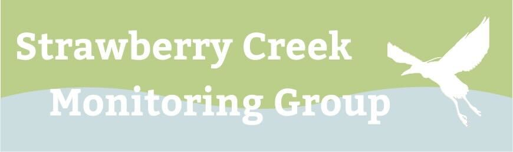
</p>

<p><a href="https://github.com/DChristensen12/StrawberryWatch/actions/workflows/lint.yml"></a> <a href="https://github.com/astral-sh/ruff"></a> <a href="https://github.com/pre-commit/pre-commit"></a>  <a href="https://pytorch.org/"></a> <a href="LICENSE"></a></p>

</div>

This repository is the research and development counterpart to the production monitoring platform. It is where anomaly detection models are built, tested against historical events, and validated!

New here? Start with the [User Manual](USER_MANUAL.md). StrawberryWatch is deployed on the SCMG Website (as of 2026-10-22).


## The Creek

The creek is monitored at eleven locations: UC Botanical Gardens, Women's Faculty Club (south fork 0), Stephens Hall (south fork 1), Downstream of Sather Gate (south fork 2), Weill Hall (south fork 3), Kingman Hall Garden, University House, Giannini Hall (north fork 0), Wickson Footbridge (north fork 1, also sometimes labeled as scnf010), Oxford Street, and Codornices Creek. The eleventh site, Codornices, is a separate watershed monitored as a standalone point.

The two forks do not behave alike. More urban activity drains into the north
fork, so it runs dirtier than the south fork: a higher baseline conductivity and
wider swings. Thresholds are fitted per node for that reason, and a deviation at
a north fork site is not comparable to the same number at a south fork one.

### Sensors + Measured Metrics

Every site runs an [EnviroDIY Mayfly Data Logger](https://www.envirodiy.org/mayfly/),
sampling every 15 minutes. Which sensors are present at which site varies, and
that is recorded in the inventory config instead of being inferred from the data, so
it is able to tell when a sensor is down and when a sensor was never installed.

| Metric | Probe | Protocol |
|---|---|---|
| Conductivity, temperature, depth | METER HYDROS 21 CTD | SDI-12 |
| Dissolved oxygen | AtlasScientific DO | analog or I2C, depending on probe generation |
| Floating conductivity | AtlasScientific Mini Conductivity K 1.0 | I2C |
| pH | AtlasScientific pH | I2C |

Conductivity, temperature and depth come from one probe, so a site has all three
or none. The rest are installed separately.

Floating conductivity sits in a sealed float inside a perforated housing and
reads the top of the water column, which is what separates a surface
contaminant like oil from one that mixes through.

Three legacy Balance Hydrologics sites are read from a separate system and serve
only the past seven days, so a gap older than a week at those sites was never
retrievable rather than broken.

Those stations predate SCMG. Berkeley monitored the creek with Balance
Hydrologics equipment first, which was bulky, heavy, expensive to install and
wired for mains and LAN. The Mayfly sites replaced that with something small,
solar powered and wireless, which is why they need no trenching and no network
drop, and also why they occasionally go quiet when the sun does.


## Models

<table align="center">
  <tr>
    <td align="center"><b>Dusk Crayfish</b></td>
    <td align="center"><b>Water Strider</b></td>
    <td align="center"><b>Flame Skimmer</b></td>
  </tr>
  <tr>
    <td align="center" width="33%">A graph neural network paired with an LSTM. It predicts what the creek as a whole should be reading next, and flags timesteps where the network differs from that.</td>
    <td align="center" width="33%">A calibrated statistical detector that checks each sensor for spikes, lasting shifts and slow drift.</td>
    <td align="center" width="33%">A Bayesian neural network. It learns a distribution over its weights rather than fixed values, so every forecast carries a calibrated uncertainty estimate.</td>
  </tr>
  <tr>
    <td align="center">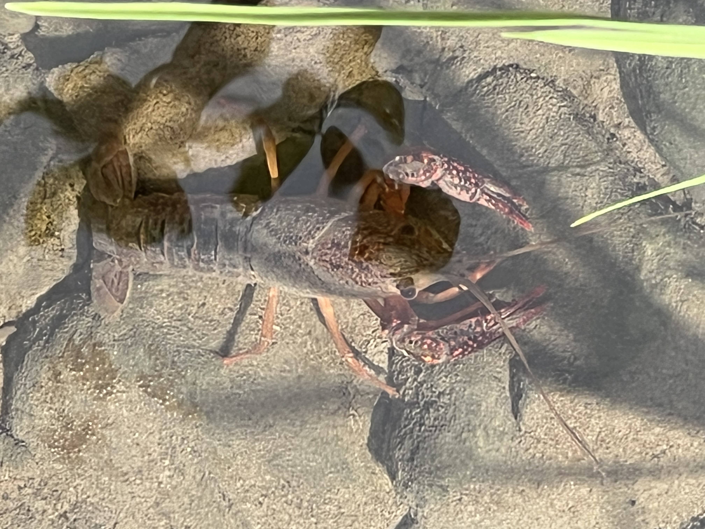</td>
    <td align="center">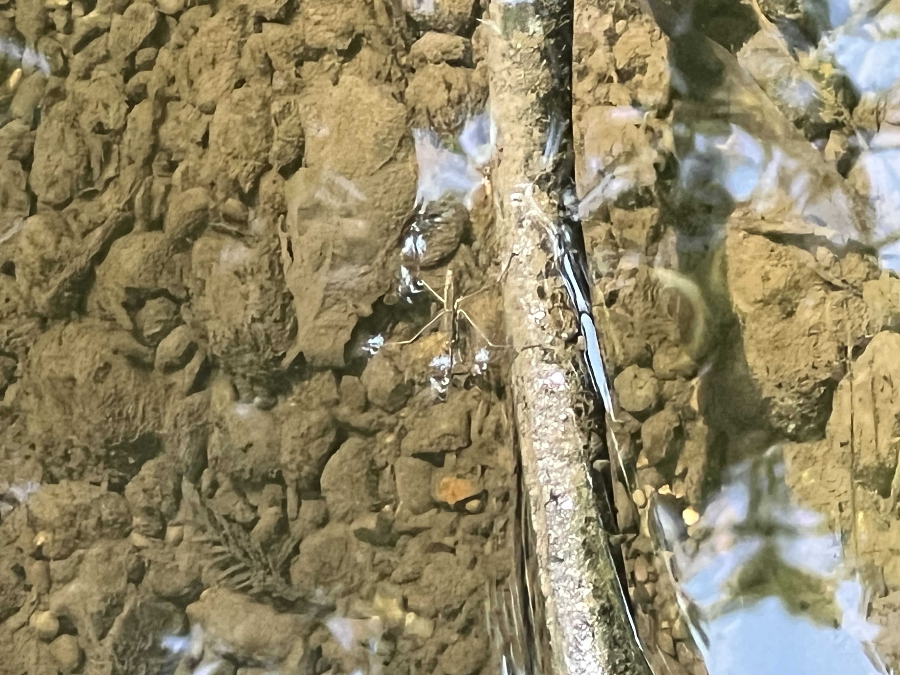</td>
    <td align="center">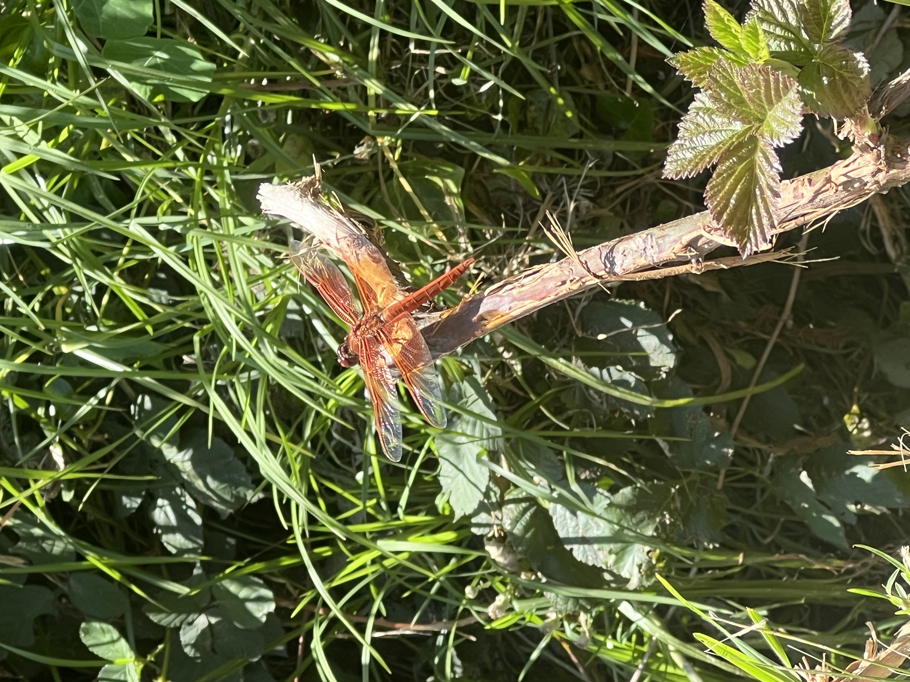</td>
  </tr>
   <tr>
    <td align="center"><b>Berry Delight</b></td>
    <td align="center"><b>Cobble Shoal</b></td>
    <td align="center"><b>Crimson Parker</b></td>
  </tr>
  <tr>
    <td align="center" width="33%">Logistic Regression Model</td>
    <td align="center" width="33%">Gradient-boosted quantile forecasting (LightGBM) with conformalized intervals</td>
    <td align="center" width="33%">Bayesian spatio-temporal stream-network model</td>
  </tr>
  <tr>
    <td align="center">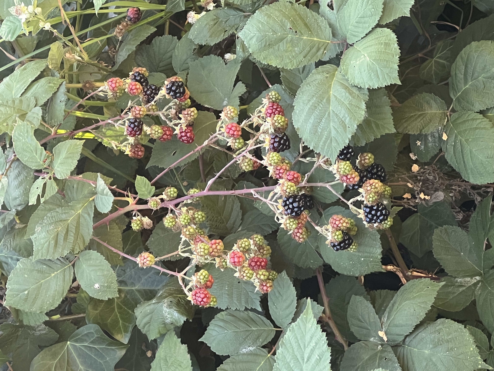</td>
    <td align="center">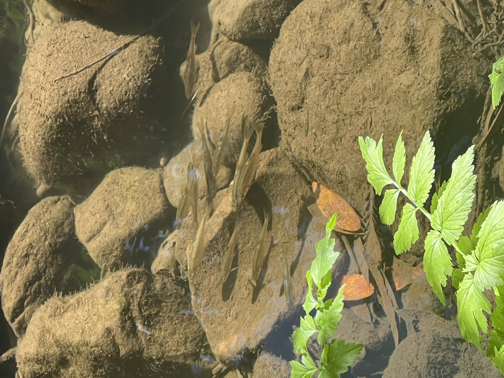</td>
    <td align="center">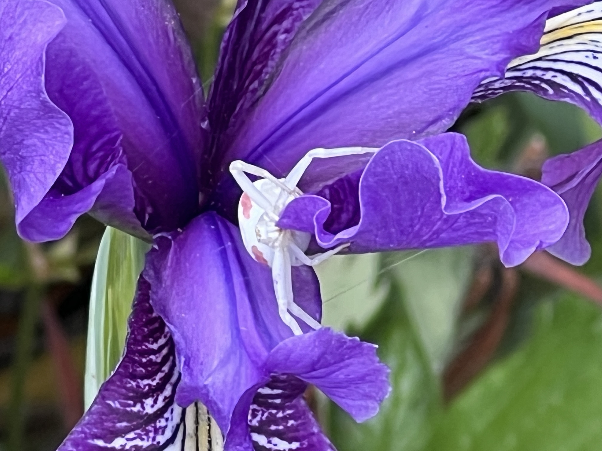</td>
  </tr>
  <tr>
    <td align="center"><b>Storm Woolly</b></td>
    <td align="center"><b>Azure Sprite</b></td>
    <td align="center"><b>Acorn Oracle</b></td>
  </tr>
  <tr>
    <td align="center" width="33%">A functional outlier detector. It treats each storm’s conductivity response as one curve, compares it to past storms, and flags storms that rise, fall or recover unusually.</td>
    <td align="center" width="33%">TBD</td>
    <td align="center" width="33%">A pretrained time-series foundation model. It forecasts a range for each sensor from upstream sites and rainfall without training on creek data, and flags readings at a set false-alarm rate.</td>
  </tr>
  <tr>
    <td align="center">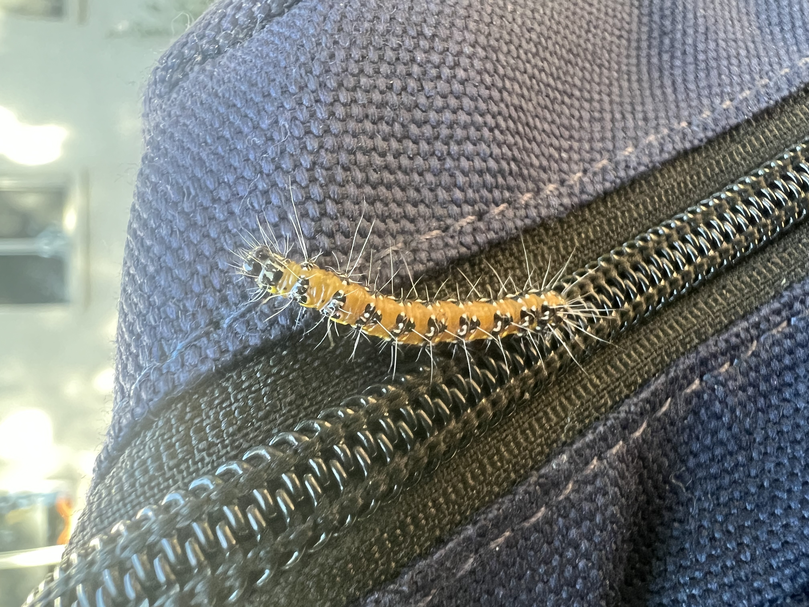</td>
    <td align="center">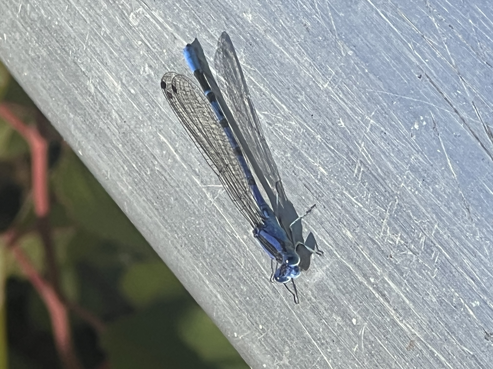</td>
    <td align="center">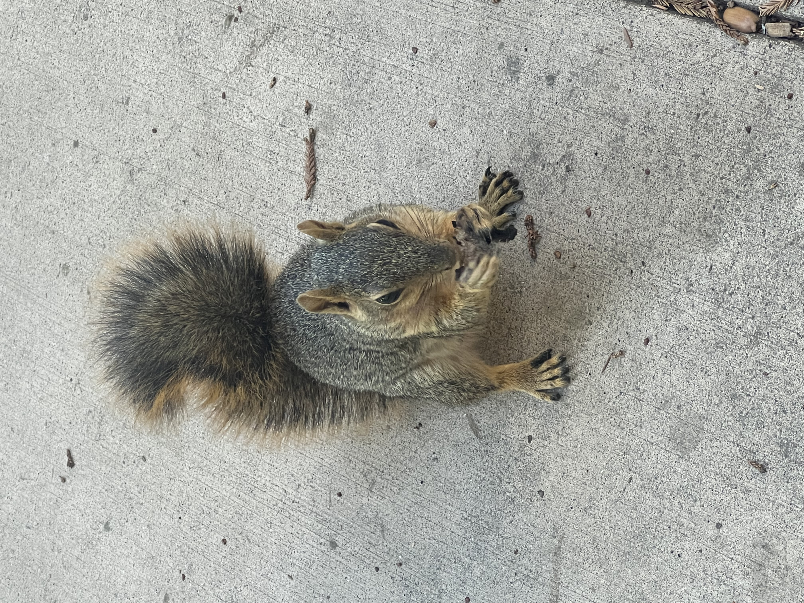</td>
  </tr>
</table>

<p align="center"><sub>Each model is named after a plant or animal found along Strawberry Creek.</sub></p>

## Support Modules

Support modules attach to any model. They are not models themselves and have no
weights of their own. Some explain a detection after it happens while others cover something a model structurally cannot see (adds tests,
so switching one on makes the model slightly less sensitive elsewhere).

<table align="center">
  <tr>
    <td align="center"><b>Trial Bed</b></td>
    <td align="center"><b>Newtwork Run</b></td>
    <td align="center"><b>Settling Pool</b></td>
  </tr>
  <tr>
    <td align="center" width="33%">Identifies what kind of contamination a detection looks like. It reads the direction each measurement moved, matches that pattern against known signatures, and reports the likely cause alongside the readings behind it.</td>
    <td align="center" width="33%">Confirms a detection travelled the way water does. A spill reaches downstream sites after a delay set by the creek's flow and never crosses forks, while rain arrives everywhere at once; comparing timing across sites separates the two and flags anything water could not have carried.</td>
    <td align="center" width="33%">Screens incoming data before it gets passed into a model. Catches placeholder values passing as real readings, feeds silently mirroring another site, sensors re-zeroed between deployments, and gaps that were filled rather than measured, each one something a model would otherwise learn from.</td>
  </tr>
  <tr>
    <td align="center">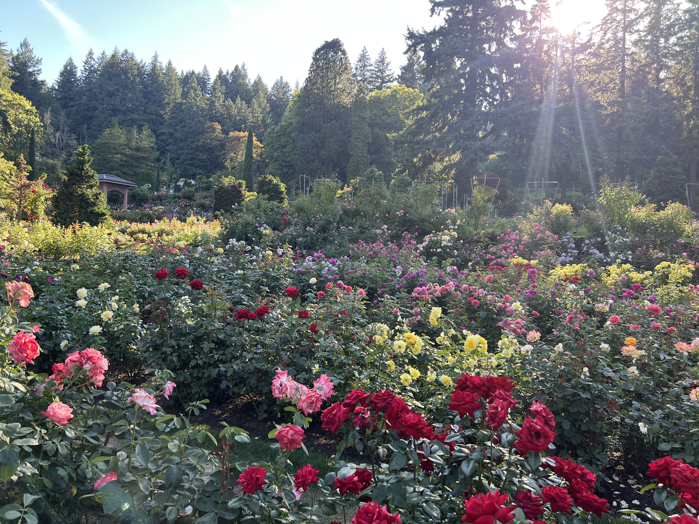</td>
    <td align="center">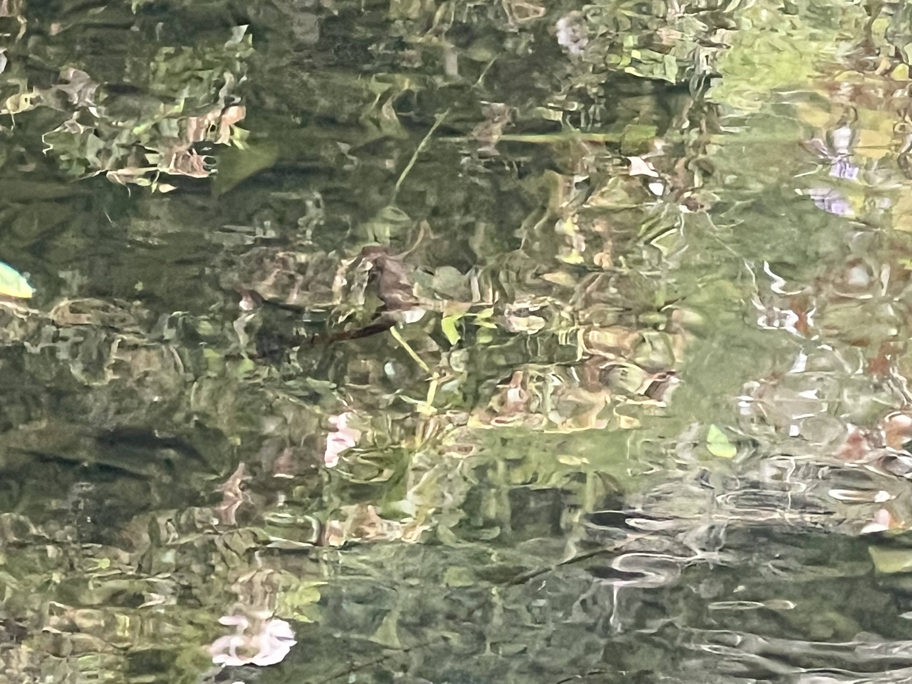</td>
    <td align="center">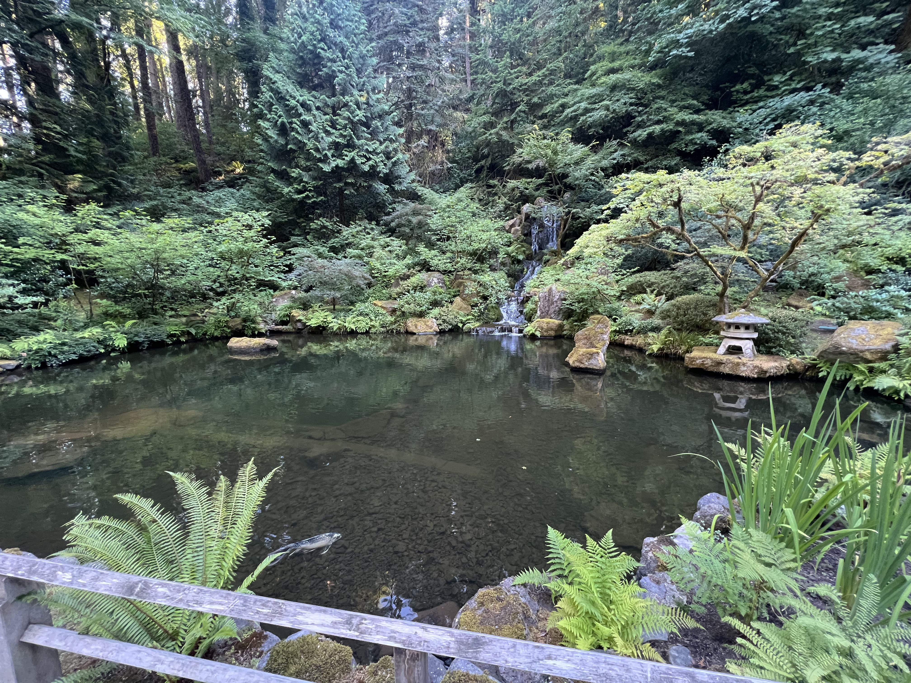</td>
  </tr>
</table>


## Dashboards and Apps

StrawberryWatch has dashboards and apps that are all connected. The admin
dashboard runs on the SCMG Website, and is only available to EH&S and SCMG
Project Leads, so it can't be opened from this repository. The admin dashboard
has the following tabs: Overview, Alerts, History, Models and Settings.
The local dashboard runs locally on your own computer and checks the creek every 15 minutes
while it is open. The Creek Explorer is a public dashboard viewable by anyone on the Strawberry Creek
Monitoring Group website (it is currently in development).

### Creek Explorer

StrawberryWatch for informative and monitoring purposes with information avaliable publically.

Currently being developed! Stay tuned for more information.

### Model Tuner

The StrawberryWatch Model Tuner is a desktop app for exploring Strawberry Creek
readings and recalibrating the anomaly detection models on this computer,
separate from the admin dashboard (so that tuning the model doesn't require access to the administrative dashboard).
It reads readings from the Strawberry Creek website, a folder of CSV files, or a MySQL database, and works offline once the
readings are downloaded. It provides seven tabs: Home, Model tuning (Pick data,
Explore, Recalibrate), Sensors, Events, Past calibrations, User manual and
Settings. Recalibrating moves each model's alert line (threshold) using the
picked data, and the model itself does not change. This first version
recalibrates Dusk Crayfish only.

Install it with its extras:

```bash
pip install -e ".[workbench]"
```

Run it in its own window, or in a browser tab:

```bash
strawberrywatch workbench
strawberrywatch workbench --browser
```

Its window needs a pywebview backend, Qt or GTK on Linux. The `--browser` flag
works without one.

Saved calibrations, events marked in the Model Tuner and downloaded readings are
stored in one folder, `platformdirs.user_data_dir("StrawberryWatch")/workbench`
(on Linux, `~/.local/share/StrawberryWatch/workbench`). The API token and the
MySQL password are kept in the system keychain, never in a file. The shipped
calibrations under `checkpoints/` and the shipped events under
`strawberrywatch/watch/events/` are never changed. A new calibration is saved
beside them and can be switched back to the shipped one at any time.

## Learning to use StrawberryWatch

Everything about installing, running and changing this system lives in the
**[User Manual](USER_MANUAL.md)**. It is the place to start, and it is beginner friendly
(including to those who have never written in Python and/or have never used a terminal before).

It covers setting up Python and a virtual environment from scratch, running each
mode with the output you should expect on your screen, editing the sensor
inventory, running the tests, and what to do when something goes wrong. Work
through it in order the first time.

| I want to | Go to |
|---|---|
| Install it for the first time | [Getting set up](USER_MANUAL.md#1-getting-set-up) |
| Run it and understand what it prints | [Running the system](USER_MANUAL.md#2-running-the-system) |
| Watch the creek from a page on your computer | [Watching the creek on your own computer](USER_MANUAL.md#watching-the-creek-on-your-own-computer) |
| Work out why the results look wrong | [When it looks like the model is wrong](USER_MANUAL.md#3-when-it-looks-like-the-model-is-wrong) |
| Know what each model does | [The models](USER_MANUAL.md#4-the-models) |
| Take a sensor out of service | [The inventory](USER_MANUAL.md#6-the-inventory) |
| Change some code and commit it | [Making a change to the code](USER_MANUAL.md#7-making-a-change-to-the-code) |
| Run the tests | [Running the tests](USER_MANUAL.md#8-running-the-tests) |
| Fix an error I am seeing | [Common problems](USER_MANUAL.md#11-common-problems) |

---

## Thank you to our contributors!

<a href="https://github.com/DChristensen12/StrawberryWatch/graphs/contributors">
  
</a>

See [CONTRIBUTORS.md](CONTRIBUTORS.md) for everyone who has helped, including
those whose contributions do not appear in the commit history.

---

<p align="center">
  
</p>
