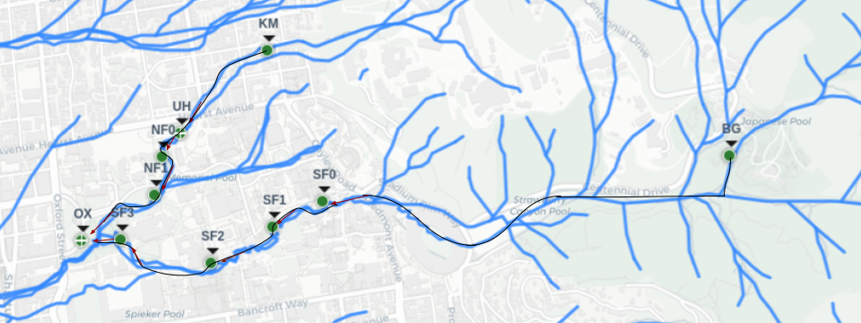

# StrawberryWatch User Manual

DOCUMENT IS A WORK IN PROGRESS. COMMANDS AND ACTUAL CONTENTS NEED TO BE UPDATED AS STRAWBERRYWATCH GETS DEVELOPED AND INTEGRATED WITH THE LIVE WEBSITE REPOSITORY.

## What this is and who should read it

This explains how to run StrawberryWatch, what its parts are, and how to change
it. You don't need to have written Python before.

The system watches Strawberry Creek for contamination. Sensors in the creek
report every 15 minutes, a model learns what normal looks like, and anything
that doesn't match gets flagged. This manual covers installing it, running it,
reading what it prints, and making the small edits that come up most often.

Read it start to finish the first time. After that, the section headings are the
index.

One thing worth knowing before you begin. Nothing in this repository
sends anything to the creek or to the public website. It reads data and prints
results. You can't break the creek from here.

If a command in this manual doesn't do what the manual says it does, the
manual is wrong, and would require fixing.

---

## Background: the creek and SCMG

You don't need any of this to run the system. It's here because the output
makes more sense once you know a bit about the creek and the group watching it.

### The creek

Strawberry Creek runs through the UC Berkeley campus and has been part of it
since the University was founded in 1868. It's an urban creek, but it still
supports native wildlife, including several endangered or threatened species
such as the Alameda whipsnake. Courses across campus use it for teaching too.

It hasn't always been in good shape. In the University's early years the creek
was used for sewage and waste discharge, which badly degraded its ecosystem. It
once had a seasonal salmon run, but development in the watershed, especially
diverting creek water for household use, is believed to have wiped out its fish
by the end of the 1800s. Restoration work began in the 1980s, and the ecosystem
has been slowly recovering since the Strawberry Creek Management Plan began in
1987.

Today the creek holds crayfish, water striders and mosquitoes, and fish
including the California roach, the Sacramento sucker and the threespine
stickleback. Upstream, the Strawberry Canyon wildlands are still home to deer,
foxes and mountain lions, though grizzly bears and elk were wiped out of the
area long ago. Wildlife corridors between watersheds let animals range across
the East Bay's undeveloped parkland. Downstream of campus is a different story.
Most of the creek's route to the Bay is culverted, which restricts habitat for
anything living in or along it.

### Culverts and runoff

The first part of the creek was culverted in 1883. The main culvert now is the
Big Inch, which carries the creek from Strawberry Canyon down to campus. It's
about 4,000 feet long, and inside there are cables for workers to use when they
head upstream. The Little Inch is only used to divert stormwater and runoff
into the creek. Both come out near the Women's Faculty Club, which is where
South Fork 0 sits.

That runoff is the reason the site is there. Sprinklers, fire hydrants and
hoses all drain into the creek, and all of them deliver tap water. EBMUD
disinfects tap water, which introduces new chemicals into the creek. The
chlorine used as the disinfectant kills microorganisms in the creek, which
disrupts the food chain and has knock-on effects for the surrounding ecosystem.

### The Stanley Hall diesel spill

In 2011 a diesel spill at Stanley Hall put around 1,000 gallons of diesel into
Strawberry Creek. The cleanup cost the University more than $1 million, and
long response times made the damage worse. The spill marked the birth of
continuous monitoring along the creek. Before real-time monitoring, the creek
was watched by eye: employees were paid to look over it as part of their job
and report any damage they saw.

Continuous monitoring began with Balance Hydrologics stations, installed in the
early 2000s. Three went in, two on Strawberry Creek and one in Codornices Creek.
Section 6 has more on them.

### Where SCMG came from

The Strawberry Creek Monitoring Group (SCMG) was founded in 2024 as an offshoot
of the Strawberry Creek Restoration Program (SCRP). It started with an SCRP
intern who wanted to set up remote watershed monitoring. Once more people were
interested, the group applied for a grant from The Green Initiative Fund
(TGIF), a student-funded grant pool for environmental student projects. That
grant paid for the sensor network, and the group has held it ever since. As of
2026 the group is going into its third year of TGIF funding.

The aim is to close the gap between environmental data and community action,
using low-cost, high-frequency sensors across the watershed to show the creek's
health in real time. Members come from majors ranging from environmental
science to computer science to civil engineering.

### Where the sensors sit

The creek is monitored at eleven sites: UC Botanical Garden, the Women's
Faculty Club (South Fork 0), Stephens Hall (South Fork 1), downstream of Sather
Gate (South Fork 2), Weill Hall (South Fork 3), Kingman Hall garden, University
House, Giannini Hall (North Fork 0), Wickson footbridge (North Fork 1, also
labelled scnf010), Oxford Street, and Codornices Creek, a separate watershed
monitored as a standalone point.

Sites are picked for three things:

- **Deep water.** The probe needs water all year, including the dry summer
  months.
- **Out of the main flow.** It sits toward the side of the stream so brush and
  other debris coming down the creek don't damage it.
- **Out of sight.** The box holding the electronics should be hidden from
  nearby walkways so strangers don't tamper with it.

Notes on individual sites:

- **South Fork 0**, by the Women's Faculty Club, watches the culvert runoff
  described above.
- **South Fork 1**, under the Stephens Hall walkway, sits right beside an old
  Balance Hydrologics station, so it's the easiest place to compare the two.
  The Balance station is mounted in a room inside Stephens Hall and depends on
  mains power and an ethernet cable run through the building. Anyone can
  unplug it, which may be why it has been inactive. The SCMG sensor beside it
  runs on a solar panel and sends its data over a cellular modem.
- **South Fork 2**, by Sather Gate, is next to a concrete bank. Concrete banks
  are bad for a creek, and natural, rough banks are much better. The crib wall
  between South Fork 1 and South Fork 2 shows the alternative: a stepped wall
  of logs filled with soil and native plants, whose roots hold the logs in
  place. It's built at the steepest angle the soil can hold without sliding, so
  it stabilizes the slope without changing the creek around it the way concrete
  does.
- **South Fork 3** is near a bank in the eucalyptus grove that's built from
  logs for the same reason. Close by is a tree that fell and that the
  University wanted gone. It was fought for and kept, and it's still alive,
  growing sideways.
- **North Fork 1** is SCMG's longest-running sensor.

Every site runs an EnviroDIY Mayfly data logger, sampling every 15 minutes.
Which probes a site has is recorded in the inventory (section 6):

| Reading | Probe | Protocol |
|---|---|---|
| Conductivity, temperature, depth | METER HYDROS 21 CTD | SDI-12 |
| Dissolved oxygen | Atlas Scientific DO | analog or I2C, by probe generation |
| Floating conductivity | Atlas Scientific Mini Conductivity K 1.0 | I2C |
| pH | Atlas Scientific pH | I2C |

Conductivity, temperature and depth come from one probe, so a site has all
three or none. The floating conductivity probe sits in a sealed float inside a
perforated housing and reads the top of the water column, which separates a
surface contaminant such as oil from one that mixes through.

### What a spill looks like

Each reading points to something different. Conductivity shows new ions,
meaning contaminants, entering the water. Temperature can hint at where a
discharge came from. Depth shows new fluid coming in.

Most of what SCMG sees is rain, tap water or fertilizer. Oil and sewage are
rarer but do happen, and they're a big part of why the creek is watched this
closely.

In June 2025, South Fork 0, 1, 2 and 3 all picked up an unknown contaminant.
Conductivity dropped steeply while depth and temperature rose. It turned out to
be warm tap water.

---

## 1. Getting set up

### What a terminal is

A terminal is a window where you type commands instead of clicking. On macOS it
is called Terminal, on Linux it's usually Terminal or Console, on Windows use
PowerShell or Windows Terminal. When this manual shows a grey box, you type what
is inside it and press Enter.

### Python 3.12

The project needs Python 3.12 or newer. Check what you have:

```
python3 --version
```

You should see `Python 3.12.x` or higher. If you see 3.11 or lower, or "command
not found", install Python 3.12 from python.org before continuing.

### Getting the code

This downloads the repository into a folder called `StrawberryWatch`:

```
git clone https://github.com/DChristensen12/StrawberryWatch.git
```

Then move into it. Every later command assumes you are inside this folder:

```
cd StrawberryWatch
```

### The virtual environment

A virtual environment is a private copy of Python that belongs to this project
alone. Without one, installing StrawberryWatch's dependencies would change the
Python your whole computer uses, and two projects wanting different versions of
the same library would fight. The environment keeps that fight from happening.

Create one. This makes a hidden folder called `.venv`:

```
python3 -m venv .venv
```

Now activate it. This tells your terminal to use that private Python instead of
the system one:

```
source .venv/bin/activate
```

Your prompt should now start with `(.venv)`. That's how you know it worked. On
Windows PowerShell the activate command is `.venv\Scripts\Activate.ps1` instead.

You need to run the activate command again every time you open a new terminal.
Forgetting it's the single most common cause of "it worked yesterday".

### Installing

```
pip install -e ".[dev]"
```

This reads `pyproject.toml`, installs PyTorch and the other dependencies, and
installs StrawberryWatch itself. The `[dev]` part adds ruff, pre-commit and
pytest, which you need for section 7 and section 8. It takes several minutes the
first time, mostly downloading PyTorch.

The `-e` means editable, and it's not optional. Without it, pip copies the code
into the environment, and your edits to the files in this folder then have no
effect on what actually runs. You would change a line, run the code, and see the
old behaviour, with nothing to tell you why. With `-e`, Python reads the files
where they sit, so an edit takes effect the next time you run.

Check it worked:

```
python -c "import strawberrywatch; print('ok')"
```

That should print `ok` and nothing else.

### The .env file

`.env` holds settings that should not be committed to git, mostly credentials.
Copy the example and edit your copy:

```
cp .env.example .env
```

`.env` is listed in `.gitignore`, so your copy won't be committed. Never put a
real password in `.env.example`.

**Required for a normal run:**

| Variable | What it is | What breaks without it |
|---|---|---|
| `SCMG_API_BASE_URL` | Where creek data is fetched from | Defaults to the public URL in `config.py`, so a missing value is usually fine |
| `NWS_USER_AGENT` | An identifying string sent with weather requests | Defaults to `SCMG-AnDeSys/1.0`. Put a real email in it, since it is how the weather service contacts you if something goes wrong |

**Optional:**

| Variable | What it is | What breaks without it |
|---|---|---|
| `SCMG_API_TOKEN` | API token | Nothing. The public API currently needs no token |
| `ALERT_EMAIL_SENDER`, `ALERT_EMAIL_PASSWORD`, `ALERT_EMAIL_RECEIVER`, `SMTP_SERVER`, `SMTP_PORT` | Email alerting | The run completes normally and prints `Failed to send email alert` at the end. Detection is unaffected |
| `MYSQL_HOST`, `MYSQL_DATABASE_USER`, `MYSQL_DATABASE_PASSWORD`, `MYSQL_DATABASE_NAME`, `MYSQL_PORT` | Direct database access, admin only | Only `--data-source sql` fails. The default `--data-source api` does not touch these |
| `USE_NWS_WEATHER` | Whether to merge weather into the dataset | Defaults to `true` |
| `ROLLING_WINDOW_DAYS` | How many days the local cache keeps | Defaults to 90 |
| `LOG_LEVEL` | How much detail gets logged | Defaults to `INFO` |

The email variables are the ones people most often leave blank. That's fine.
The run still works and still prints what it found.

---

## 2. Running the system

Everything runs through `main.py`. To see the options at any time:

```
python main.py --help
```

```
usage: main.py [-h] [--mode {train,update,inference}]
               [--data-source {api,sql}]
               [--model {dusk_crayfish,cobble_shoal}]
               [--support NAME [NAME ...]] [--q-total Q_TOTAL]
               [--data-file DATA_FILE]
               [--operating-point KEY=VALUE [KEY=VALUE ...]]
               [--alert-sites SITE [SITE ...]] [--dry-run]
               [--results-json PATH]

SCMG GNN Pipeline

options:
  -h, --help            show this help message and exit
  --mode {train,update,inference}
  --data-source {api,sql}
                        Where to pull data from: REST API (default) or SQL
                        database
  --model {dusk_crayfish,cobble_shoal}
                        Which model architecture to use
  --support NAME [NAME ...]
                        Support modules to attach, space separated. Order does
                        not matter. Omit for a run with no support. Valid
                        names: newtwork_run, settling_pool, trial_bed
  --q-total Q_TOTAL     Total false alarm rate for the whole run, divided
                        across the primary and every attached detector rather
                        than handed to each. Default 0.0001.
  --data-file DATA_FILE
                        Path to the data CSV, overriding the default cache.
                        Accepts either the long-format rolling cache or a wide
                        training-corpus CSV (see
                        scripts/build_training_corpus.py; auto-detected by
                        *_valid columns). Omit to use the default cache,
                        unchanged.
  --operating-point KEY=VALUE [KEY=VALUE ...]
                        Override detection constants for this run, space
                        separated. Keys: level_shift_k, min_timesteps_over,
                        min_timesteps_to_judge. Omit to use anomaly_detector's
                        own values.
  --alert-sites SITE [SITE ...]
                        Only email about these sites. Every site is still
                        scored, the rest just stay quiet. Omit to alert on all
                        of them. Valid names: north_fork_0, south_fork_2,
                        south_fork_1, oxford
  --dry-run             Print the alerts this run would email and send
                        nothing.
  --results-json PATH   Also write what the run found to PATH as JSON: per
                        site verdicts, explainer accounts, and every alert
                        with whether it was sent.
```

### The three modes

**`--mode inference`** pulls the last 2 days of data, loads the saved weights,
and scores. It changes no weights. This is the one you'll run most, and it's
what the monitoring loop runs.

```
python main.py --mode inference
```

**`--mode update`** pulls 30 days, continues training from the existing weights,
and saves them. It overwrites `checkpoints/<model>/<model>_weights.pt` and
`checkpoints/<model>/<model>_metadata.pkl`.

```
python main.py --mode update
```

**`--mode train`** pulls 30 days and trains from scratch, discarding the
existing weights.

```
python main.py --mode train
```

Both `update` and `train` overwrite the saved weights, and the current weights
are the baseline every historical event test is judged against. Don't run
either one because you are curious. Ask first. See section 13.

If no weights exist at all, `update` and `inference` say so and fall back to
training, so a fresh clone with an empty `checkpoints/` folder will train on its
first run.

### What a normal run looks like

Here is the beginning of a real `--mode inference` run:

```
SCMG Anomaly Detection System
Execution Mode: INFERENCE
Model:          dusk_crayfish
Device:         cpu
Data file:      /home/you/StrawberryWatch/data/processed_data/full_creek_gnn.csv
Support:        none
False alarm budget: q_total=0.0001, primary=0.0001
Refresh requested. Fetching last 2 days from API...
Requesting data: north_fork_0...
Requesting data: south_fork_2...
Requesting data: south_fork_1...
Requesting data: oxford...
Fetching Open-Meteo weather (window: 2d, source: Historical Forecast API, 15-min native)...
Weather merged: 759/759 rows have weather context (features: ['air_temp_c', 'rain_mm', 'shortwave_radiation'])
Trimmed 1,092 rows older than 90 days.
Cache updated: 32,195 rows on disk (2026-05-22 22:45:00+00:00 to 2026-08-20 22:45:00+00:00)
data loaded:
Rows: 32,195
Range: 2026-05-22 22:45:00+00:00 to 2026-08-20 22:45:00+00:00
Sites present (4): ['north_fork_0', 'oxford', 'south_fork_1', 'south_fork_2']
Active features (10): conductivity, depth, temperature, air_temp_c, rain_mm, shortwave_radiation, hour_sin, hour_cos, dayofyear_sin, dayofyear_cos
```

Reading that: it fetched four sites, merged weather onto every row, trimmed the
cache back to 90 days, and ended up with about 32,000 rows. `Device: cpu` is
normal. A graphics card would say `cuda` and would only be faster.

Then it builds the model's input and scores. There's a long progress bar during
`Pivoting data`, which is normal and takes about twenty seconds.

The last lines are the answer. A quiet creek looks like this:

```
Detection cycle finished. Nodes judged: 4/4. Nodes flagged: 0.
```

### What a run that found something looks like

```
Detection cycle finished. Nodes judged: 4/4. Nodes flagged: 3.
  north_fork_0: forecast_residual, peak_deviation=68.48, duration=4 timesteps (31 total over threshold)
  north_fork_0: level_shift, peak_deviation=4.35, duration=5 timesteps (8 total over threshold)
  south_fork_2: forecast_residual, peak_deviation=188.68, duration=3 timesteps (42 total over threshold)
  south_fork_1: forecast_residual, peak_deviation=354.83, duration=7 timesteps (55 total over threshold)
```

Reading that:

- **Nodes judged: 4/4** means all four modelled sites had enough data to score.
  A site with a dead sensor would show as judged 3/4.
- **Nodes flagged: 3** is how many sites crossed their threshold.
- **forecast_residual** means the reading differed from what the model expected
  next. **level_shift** means the reading moved to a new level and stayed there.
  A site can trip both, as north_fork_0 did here.
- **peak_deviation** is how far past the threshold it got at its worst. Bigger is
  a stronger signal. It's not a concentration and it's not in any physical
  unit.
- **duration** is the longest unbroken run of timesteps over the threshold. The
  number in brackets is the total count over the threshold anywhere in the
  window. A long unbroken run matters more than a scattered total.

A flag is not a confirmed spill. It says these readings don't match what the
creek normally does. Look at the readings, check whether it rained, and escalate
by whatever your group's procedure is.

If email is configured, an alert is sent. If it's not, you'll see this and
can ignore it:

```
Failed to send email alert: (535, b'5.7.8 Username and Password not accepted.
```

### Continuous monitoring

To run inference every 15 minutes, indefinitely:

```
python scripts/run_live.py
```

It prints a timestamped banner per cycle, runs `main.py --mode inference` as a
separate process so each cycle starts with clean memory, then sleeps 15 minutes.

**To stop it, press Ctrl and C together in that terminal.** It prints
`Monitoring stopped by user.` and exits. Closing the terminal window also stops
it. There's no background service and no PID file, so if you want it to survive
a logout you need systemd or cron, which is not set up here. See the gaps in
section 13.

### Trying settings for one run

`main.py` can take different numbers for a single run, so nobody has to edit a
file everyone shares just to try something:

- **`--operating-point KEY=VALUE`** overrides the detection constants.
  `level_shift_k` is how many robust deviations Rule 2 needs (default 4),
  `min_timesteps_over` is how many scored steps over a bar it takes to flag
  (default 3), and `min_timesteps_to_judge` is how many real readings a site
  needs before it's scored at all (default 30).
- **`--alert-sites`** limits which sites get emailed about. Every site is still
  scored. The ones you leave out show up as muted instead of sending.
- **`--dry-run`** prints what would have been emailed and sends nothing.
- **`--results-json PATH`** writes what the run found to a file: every site's
  verdict, what the support modules said, and each alert with whether it went.

Anything in `settings.yaml` can be changed for one run too. Write a yaml with
the same sections, holding only what changes:

```
detection:
  rain_multiplier: 3.0
```

and point `STRAWBERRYWATCH_SETTINGS` at it:

```
STRAWBERRYWATCH_SETTINGS=my_settings.yaml python main.py --mode inference --dry-run
```

Keys you leave out keep `settings.yaml`'s value. The run's header prints
`Settings: settings.yaml + my_settings.yaml`, so the log says which numbers it
actually ran on.

### The Workbench

The Workbench explores the creek's readings and recalibrates the models on
this computer, apart from the dashboards. It reads from the Strawberry Creek
website, a folder of CSV files or a MySQL database, and works offline once the
readings are downloaded. Recalibrating moves a model's alert line (threshold)
using the picked data, and the model itself does not change. This version
recalibrates Dusk Crayfish and Cobble Shoal. It needs its extras once:

```
pip install -e ".[workbench]"
strawberrywatch workbench
strawberrywatch workbench --browser
```

The first opens its own window, which needs a pywebview backend (Qt or GTK on
Linux). `--browser` opens a browser tab instead and needs neither. Its User
manual tab shows Appendix E. Saved calibrations, marked events and downloaded
readings live in `~/.local/share/StrawberryWatch/workbench` on Linux, and the
API token and MySQL password in the system keychain. The shipped calibrations
under `checkpoints/` and the shipped events never change.

### Watching the creek on your own computer

The local dashboard runs the models against the real creek for as long as it's
open. It needs its extras once, then one command:

```
pip install -e ".[dashboard]"
strawberrywatch dashboard
```

It prints a link and opens it. The link works once and signs that browser in,
so copy it straight away if you want it somewhere else. The first time, it asks
where readings should come from:

- **The Strawberry Creek API.** You need your own token; the API page on the
  website says how to get one. It's kept in your computer's keychain and never
  written anywhere else, so it isn't in the dashboard's files, its logs or the
  page.
- **A folder of CSV files.** One file per site, named after it
  (`south_fork_1.csv`), with a time column and the raw logger columns. No token
  needed.
- **A past event.** The labelled events ship with the package, so this works
  offline and checks the whole event at once. Start here if you want to see what
  it does before connecting anything.

While it's open, the models that are on check the creek every 15 minutes.
Closing it stops them, so there's no separate on switch. Nothing it notices
leaves the computer unless you turn on email alerts, and nothing is ever sent to
the website.

It looks like a page of strawberrycreek.org, with the same dark mode button, and
has five tabs:

- **Overview** says in one line whether the creek looks normal, something looks
  unusual, or a site has stopped reporting, then shows the creek map and every
  site's status.
- **Unusual readings** has the details of anything the models noticed in the
  last day, with a chart for each. The tab shows how many there are.
- **History** lists unusual readings and settings changes by day or by hour.
  Opening a day shows it hour by hour, with how many checks ran. Notes you've
  written show under the reading they're about, and **Your notes** beside the
  heading lists them all, filtered by site and date. Tick the ones you want, or
  none for everything shown, then **Download as CSV** for a spreadsheet or
  **Save as PDF**, which opens a print page where you pick Save as PDF as the
  printer.
- **Models** describes each model and whether it's on.
- **Settings** chooses which sites to watch, how many alerts you want, rain and
  which models are on. Advanced settings, linked from it, has each model's own
  values. **Email alerts**, also linked from it, is the list of people who get
  an email when a check notices something new. Adding or removing someone takes
  effect straight away. Sending starts off: turn it on there once **Send a test
  email** has reached everyone. It sends through the account in `.env` that
  `main.py`'s alerts use (`ALERT_EMAIL_SENDER`, `ALERT_EMAIL_PASSWORD`,
  `SMTP_SERVER`, `SMTP_PORT`), with each address hidden from the others.
  Replays of past events never send email.

Settings and Advanced settings share one draft, kept as you edit, so moving
between pages doesn't lose it. A note at the top says how many changes aren't
saved yet. Save changes, at the bottom, lists every change before and after and
runs StrawberryWatch's own checks on it; saving there checks the creek straight
away. Discard changes, beside it, appears once there's something to discard.

Settings, scores and what was noticed live in one file in your user data folder
(`~/.local/share/strawberrywatch` on Linux), readable only by you. Deleting the
folder starts it over.

To see the dashboard exactly as the website shows it, before anything goes on
the website, run `python test_live_dashboard/run.py` (Appendix D).

---

## 3. When it looks like the model is wrong

Usually it isn't. When the output looks wrong, or a site seems to have stopped
making sense, the sensors are the first thing to check and the model is close to
the last.

**A sensor is down.** The probes are solar powered and run independently of any
building's mains, which is what lets them sit out in the creek at all. It also
means they go quiet from time to time: a run of overcast days, a battery that
never fully recovered, leaves or silt over a panel. This is expected. It happens
occasionally and it is not a fault in the software.

The run output tells you when it has happened. `Nodes judged: 3/4` means one site
didn't have enough data to score, so that site isn't being watched that cycle at
all. Sites that share a flow path with it also lose the neighbour the model would
normally lean on, so their numbers can look odd while nothing is wrong with the
model itself.

**A sensor was tampered with or destroyed.** At least one sensor a year gets
stolen, and that has held true as of 2026. Not every case is theft: at South
Fork 1, the same person unplugged the sensor twice. Theft and vandalism look
exactly like a flat battery from here, so if a site goes quiet and stays quiet
for days, send someone to look at it rather than waiting for the sun to come
back.

Once you know a probe is gone, take it out of service in the inventory so the
system stops expecting readings from it. See section 6.

**North fork runs dirtier than south fork.** More urban activity drains into the
north fork, so its baseline conductivity sits higher and swings wider than the
south fork's. A number that would be alarming at a south fork site can be an
ordinary day at `north_fork_0`.

The model already accounts for this, because thresholds are fitted per node and
each site is judged against its own history. What you should not do is compare
`peak_deviation` between two sites and conclude the larger one is in worse shape.
That number only means something against the same site over time.

**A gap at Oxford, University House or Codornices may never have existed.** Those
three are the legacy Balance Hydrologics stations, they are read from a separate
system, and that system only serves the last seven days. A hole older than that
was never retrievable and nobody broke it. See section 6.

So the order to work through is: check the judged count, check the inventory,
check whether the probe is physically still there, then consider the model.

---

## 4. The models

Each model is named after a plant or animal found along Strawberry Creek, and
each is a different approach to the same question.

Dusk Crayfish is the model deployed on the website, as of 2026-08-20. We update
this date whenever the deployment changes, since nothing else in the code
records which model is live.

| Model | What it is | State |
|---|---|---|
| Dusk Crayfish | A graph neural network paired with an LSTM, forecasting the whole creek | Deployed, runs through `main.py` |
| Cobble Shoal | A graph neural network that scores every sensor separately | Runs on the dashboards |
| Water Strider | A calibrated statistical detector that checks each sensor for spikes, lasting shifts and slow drift. | Runs on the dashboards |
| Flame Skimmer | A Bayesian neural network, whose forecasts carry a calibrated uncertainty | Runs on the dashboards |
| Berry Delight | Logistic regression | Not built |
| Crimson Parker | A Bayesian spatio-temporal stream-network model | Not built |
| Storm Woolly | A functional outlier detector that compares each storm's conductivity curve with past storms | Not built |
| Acorn Oracle | A pretrained time-series foundation model forecasting a range from upstream sites and rainfall | Not built |
| Azure Sprite | Name reserved | Not built |

### Dusk Crayfish

A graph neural network paired with an LSTM. It treats the creek as a connected
graph and predicts what the network as a whole should read next, then flags
timesteps where reality differs. It is unsupervised: trained only to predict
the next reading from recent history, so anything it predicts badly is
something it has not seen before.



The map shows the full field deployment. The model runs on a four-node core of
it, the main flow path where conductivity data is reliable. The north path runs
straight from north_fork_0 to Oxford because the footbridge node between them
was retired, though the water still flows that way.

- **Good at:** events that show up as a whole site behaving oddly, and events
  that propagate downstream. It knows which site is upstream of which.
- **Can't see:** which individual sensor at a site is wrong. It scores a site,
  not a probe, so a site with a bad conductivity probe and three healthy ones
  scores as one number. It also can't run on sites outside its four-node core.
- **Runs on:** north_fork_0, south_fork_1, south_fork_2, oxford. The other seven
  sites are not modelled yet.
- **Rain:** from the National Blend of Models (Open-Meteo's `ncep_nbm_conus`),
  saved as `rain_nbm_mm`, since November 2026. Its air temperature and solar
  radiation, and Water Strider's rain, come from Open-Meteo's default model,
  which is HRRR at Berkeley.
- **Currently runnable:** yes.

```
python main.py --model dusk_crayfish --mode inference
```

#### The winter verdict on storm mode

Two storm-mode methods for Dusk Crayfish are undecided. The mixing method
expects storm-time conductivity from a mix of pre-storm water and runoff, and
the depth-fit method from a line in log depth. On the 22 old storm groups the
mixing method passed by less than one false alarm, and the depth-fit method
came close. Both are frozen in `checkpoints/dusk_crayfish/storm_mode/frozen.json` and judged
on the winter's storms by the rule in Appendix A, which also says what each
verdict means. Nothing runs live. After 31 March 2027 we run one command from
the repository's folder:

```
python -m scripts.winter_verdict --start 2026-11-17 --end 2027-03-31
```

The script pulls the readings from the public SCMG API and the rain from
Open-Meteo, neither of which needs an account, scores the five frozen NBM
checkpoints on the new storms and on fake faults placed in them, and prints the
verdict: mixing, depth fit, current model or inconclusive. It saves each stage
in `data/processed_data/winter_verdict/`, so a second run skips what is done. A
winning method's fitted scale is 2.35 to 2.55, which the current model's
rain-line range on the Settings page has to widen to hold.

### Cobble Shoal

Also a graph neural network with an LSTM, but it scores every sensor separately.
A node is a (site, variable) pair, so it sees 17 nodes where Dusk Crayfish sees 4
sites. It learns how fast each reading goes stale and combines several
independent checks, so it can name which sensor looks wrong.

- **Good at:** naming the specific probe. It also has a check for a sensor that
  has frozen, which a forecast-based approach structurally can't see.
- **Can't see:** it has no weather input at all, by design, so it can't tell a
  rain event from a contamination event on its own.
- **Currently runnable through `main.py`: no.** It's registered as a `--model`
  choice, but running it stops here:

```
python main.py --model cobble_shoal --mode inference
```

```
ERROR: weights exist at .../checkpoints/cobble_shoal/cobble_shoal_weights.pt but
metadata is missing at .../checkpoints/cobble_shoal/cobble_shoal_metadata.pkl.
Cannot determine the trained feature set. Retrain with --mode train.
```

  Its weights exist but its metadata file doesn't, and `main.py` won't guess
  at a feature set. It can be scored outside `main.py`, where it reads the data
  through a different path:

```
python scripts/run_audit_comparison.py
```

  Wiring it into `main.py` properly is unfinished work. See section 13.

### Flame Skimmer

A Bayesian neural network. It learns a distribution over its weights rather
than fixed values, so every forecast carries a calibrated uncertainty estimate.
It works like Cobble Shoal, but forecasts a range instead of a single value.
It runs on the dashboards, switched on in Settings, and not through `main.py`.

### Water Strider

A calibrated statistical detector that checks each sensor for spikes, lasting
shifts and slow drift, using statistics fitted to past data, so each alert can
be explained in one sentence. It runs on the dashboards, and not through
`main.py`.

### The models not built yet

Berry Delight, Crimson Parker, Storm Woolly, Acorn Oracle and Azure Sprite are
named in the table above. No file exists for any of them.

---

## 5. The support modules

A support module attaches to any model. It has no weights of its own and is not
a model. You attach one or more with `--support`:

```
python main.py --mode inference --support trial_bed newtwork_run settling_pool
```

The run then prints what attached:

```
Support:        newtwork_run, settling_pool, trial_bed
  newtwork_run: reads firing order along the flow graph to separate transport from a catchment wide cause (explainer, no budget)
  settling_pool: flags readings against the inventory's per site thresholds and sensor state (screen, no budget)
  trial_bed: matches the direction each channel moved against the spill signature table (explainer, no budget)
False alarm budget: q_total=0.0001, primary=0.0001
```

Order doesn't matter. Omit `--support` entirely for a run with nothing attached.

### Explaining versus testing, and why it matters

Modules come in four kinds, and the difference decides whether switching one on
changes how sensitive the system is.

- An **explainer** reads a detection that already happened and says what it looks
  like. It adds no test. Switching it on can't change what fires.
- A **screen** filters readings before the model sees them. It adds no test
  either, but it does change the model's input, so the thresholds were fitted on
  unscreened data and no longer describe it exactly.
- A **detector** adds its own score, which is a second test. Two tests running at
  the same false alarm rate produce twice the false alarms, so the budget
  `--q-total` gets divided between them rather than handed to each. Attaching a
  detector makes the primary model slightly less sensitive, because it's now
  spending part of the budget.
- A **modulator** moves the threshold up or down without adding a test.

**All three modules currently in the repository are explainers or a screen. None
is a detector, so none of them costs you any false alarm budget today.** The line
`(explainer, no budget)` in the output above is how you check. If a module ever
prints a `q=` line under it, it's a detector and it's spending budget.

### The three modules

**Trial Bed** (explainer). Identifies what kind of contamination a detection
looks like. It reads which direction each measurement moved and matches that
pattern against a table of known signatures, then reports the likely cause with
the readings behind it. Costs nothing.

**Newtwork Run** (explainer). Confirms a detection travelled the way water does.
A spill reaches downstream sites after a delay set by the creek's flow and never
crosses between forks. Rain arrives everywhere at once. Comparing the timing
across sites separates the two. Costs nothing.

**Settling Pool** (screen). Screens incoming data before the model sees it.
Catches placeholder values passing as real readings, one feed silently
duplicating another, sensors re-zeroed between deployments, and gaps that were
filled rather than measured. Costs no budget, but it does change what the model
is fed.

---

## 6. The inventory

This is the file you are most likely to need to edit. It records which sensor is
at which site, when it went in, and whether it's in use right now.

It lives at `strawberrywatch/inventory.yaml`.

### The grid at the top

Open the file. The first thing you see is this:

```yaml
# What's running where. yes = installed and in service,
# no = installed but out of service, - = no such probe at this site.
# For a new probe, set its cell to yes and give it an install date under sites: below.
# do = dissolved oxygen, fc = floating conductivity, ph = pH. ctd is depth,
# temperature and battery voltage (battery isn't used for anomaly detection).
# Check an edit with: python -m strawberrywatch.inventory
in_service:
  botanical_garden:  {ctd: yes, do: -,   fc: -,   ph: -}
  south_fork_0:      {ctd: yes, do: -,   fc: -,   ph: -}
  south_fork_1:      {ctd: yes, do: -,   fc: -,   ph: -}
  south_fork_2:      {ctd: yes, do: -,   fc: -,   ph: -}
  south_fork_3:      {ctd: yes, do: yes, fc: yes, ph: -}
  kingman_hall:      {ctd: yes, do: -,   fc: -,   ph: -}
  north_fork_0:      {ctd: yes, do: -,   fc: -,   ph: -}
  scnf010:           {ctd: yes, do: yes, fc: yes, ph: -}
  university_house:  {stage: yes, balance_feed: yes}
  oxford:            {stage: yes, balance_feed: yes}
  codornices:        {stage: yes, balance_feed: yes}
```

One row per site, one column per sensor. The column names are `ctd` (the
conductivity, temperature and depth probe, which is one instrument reporting
three channels), `do` (dissolved oxygen), `fc` (floating conductivity) and `ph`.
The three legacy Balance Hydrologics sites at the bottom have different columns,
`stage` and `balance_feed`, because they are a different kind of station.

Those three predate SCMG. Before this project existed, creek monitoring at
Berkeley ran on Balance Hydrologics stations, which were bulky, heavy, expensive
to install, and wired for mains and LAN. That is the reason the current probes
look the way they do: small, solar powered, and wireless, so a site needs no
trenching and no network drop. It is also why the three old stations are still
described differently here. They were never the same kind of instrument.

They do cover the same parameters, though. A Balance station cost around
\$20,000, and an SCMG site measures the same things for around \$1,500.

One consequence matters when you are reading results. The Balance feed is
scraped from a separate system that only serves the last seven days, set by
`balance_service_days` further down this file. A gap older than that at Oxford,
University House or Codornices was never retrievable in the first place, so the
system reports it as "not installed" rather than as a broken sensor. Nobody
broke it and there is nothing to fix.

Three values are allowed and nothing else:

- `yes` means the probe is installed and in use.
- `no` means the probe is installed but switched off right now.
- `-` means there's no such probe at that site.

Note the difference between `no` and `-`. `no` is a probe that exists and is
temporarily out. `-` is a probe that was never fitted. Getting these mixed up is
the mistake the file is designed to catch.

### Taking a sensor out of service

Say the dissolved oxygen probe at scnf010 has been pulled for cleaning. Find its
row, change `do: yes` to `do: no`, and save:

```yaml
  scnf010:           {ctd: yes, do: no,  fc: yes, ph: -}
```

That's the whole edit. Nothing else in the file changes and no code changes.
Keep the spacing so the columns stay lined up, but the file will load either way.

To put it back, change `no` to `yes`.

To take a whole site out, set every one of its sensors to `no`. There's no
separate site level switch, on purpose, because a site switch and a sensor
switch could contradict each other.

Switching a probe off removes it from live scoring. Its older readings are still
used for training, because history doesn't change when you unplug something.

### Checking your edit worked

```
python -m strawberrywatch.inventory
```

This prints the grid back to you, plus everything the grid can't show. Compare
the grid it prints against the file. The first part looks like this:

```
Strawberry Creek sensor inventory
/home/you/StrawberryWatch/strawberrywatch/inventory.yaml

WHAT IS RUNNING WHERE   (yes in service, no switched off, - no such probe)

  botanical_garden:  {ctd: yes, do: -,   fc: -,   ph: -}
  south_fork_0:      {ctd: yes, do: -,   fc: -,   ph: -}
  ...

SWITCHED OFF
every probe in the grid is in service
```

If you switched something off, the SWITCHED OFF section names it instead.

Further down it prints install dates, which dates were guessed rather than
known, any rows dropped from the archive, and a FILE AGAINST DATA section that
names disagreements between what the file claims and what the data shows. A site
marked in service that has not reported in two hours gets named there, and so
does a site marked out of service that's still sending readings. It never
changes the file for you.

### The error you'll get if you write `true`

`yes` and `no` are the only spellings accepted. `true`, `True`, `1`, `on` and
`"yes"` in quotes are all rejected. That's deliberate. YAML treats several of
those as the same thing without telling you, and a typo that silently switches a
sensor off is worse than an error.

If you write `ctd: true` and run the check, you get this:

```
The inventory file has a problem and nothing will run until it is fixed.

inventory.yaml line 20: the ctd switch for south_fork_1 is set to 'true', which is not yes, no or -

Write one of these three, in lower case, with no quotes:
    ctd: yes   installed and in service
    ctd: no    installed, switched off right now
    ctd: -     there is no ctd probe at south_fork_1
```

**What to do:** go to the line number it names, in the file it names, and write
one of the three spellings it lists. That's all. Every validation error in this
file follows the same shape: where the problem is, what is wrong, and what to
write instead.

Nothing runs until you fix it, on purpose. A run that dropped a site because of
a typo and said nothing is worse than a run that refuses to start.

### When a new probe is installed

A new probe needs two edits, because the grid can't hold a date.

First, change that sensor's `-` to `yes` in the grid. Then add its install date
in the site's detail block further down the file. If you forget the second step,
the error tells you exactly what to write:

```
the grid says upstream has a do probe, but no install date is written for it below

Add the date the probe went in, under sites: upstream: sensors: do:
      do:
        install: '2026-03-05'
        removed: null
Use the real date. If there is no do probe here, set the
do column of the upstream row back to -.
```

Use the real install date, not today's date, and not a guess. The date decides
which past readings are treated as real, so a wrong one either invents years of
missing data or hides real gaps.

### Correcting a guessed install date

Many install dates in the file were guessed from the first reading in the
archive because nobody recorded the real one. They are marked:

```yaml
      ctd:
        # GUESSED off the first reading. Replace when you know the real date.
        install: '2025-12-04'
        removed: null
        inferred: true
```

If you know the real date, write it in and delete the `inferred: true` line and
the comment above it. The check command lists every guessed date under GUESSED
INSTALL DATES, so you can see what still needs an answer.

The file marks one entry as the most likely wrong, at the top of scnf010's block.
Fix that one first if you can find out the answer.

### Data levels, the field log and sensor alerts

StrawberryWatch keeps three levels of the same sensor data, following Campbell
et al. (2013). The raw level is
each reading as fetched, and nothing edits or deletes it. The screened level is
raw plus a flag for each reading and for each test that judged it, in the codes
of the Quality Assurance / Quality Control of Real-Time Oceanographic Data
(QARTOD) program. The
reviewed level is the screened data minus the periods recorded in the field
log. The ingest job writes raw and screened every 15 minutes, apart from the
model checks. Live checks read screened, and training, calibration and the
tests read reviewed. Readings flagged FAIL or MISSING never reach a model, while
SUSPECT readings stay in with their flag recorded.

The field log is `strawberrywatch/field_log.csv`, beside the inventory. Each
line records one thing someone saw or did at a sensor:

```
date,time,site,sensor,event,end,note,who,confirmed,value_before,value_after
2026-06-01,09:30:00-07:00,south_fork_0,ctd,cleaned,,wiped the cell,Ana,yes,412.5,398.0
```

| Column | What it holds |
| --- | --- |
| `date` | Year-month-day |
| `time` | RFC 3339 with its offset from Coordinated Universal Time (UTC): `-07:00` in summer, `-08:00` in winter, or `Z`. Left empty, the line covers the whole Pacific day |
| `site` | The site's table name, as in the inventory |
| `sensor` | A probe (`ctd`, `do`, `fc`), one of its readings (`conductivity`), or `all` |
| `event` | One of cleaned, calibrated, swapped, installed, removed, stolen, fouled, out_of_water, buried, units_changed, bad, visit_ok or discharge |
| `end` | For events that last, such as `2026-04-28T16:00:00-07:00`, or a date alone for the end of that day |
| `note`, `who` | Free text. The file is public with the code, and we recommend initials in `who` |
| `confirmed` | yes when someone saw it at the creek, and no when it was worked out from the data |
| `value_before`, `value_after` | The readings either side of a cleaning or calibration, for a drift correction later |

Readings inside a bad, fouled, out_of_water or buried period leave the
reviewed level, as do readings after a units_changed date. A visit_ok line
records that someone checked the sensor and it was fine, which gives the tests
their true negatives. A discharge line records something other than rain
entering the creek, such as a spill or a hydrant flush, from its time to its
end, or over its day. The winter verdict (section 4) grades storm mode on the
confirmed ones. An entry in `tests/events.yaml` can cite field log lines
as evidence under `field_log:`, written as `date site sensor event`. We check
an edit with:

    python -m strawberrywatch.field_log

A wrong line is named with its line number and the fix, the same way the
inventory's errors are.

A sensor alert means a probe needs attention, not that the creek changed. The
data checks raise one in six cases: (1) a reading the screen failed, such as a
-9999 or a reading outside what the probe can report, (2) a depth between -25
and -250 mm, where the probe is possibly out of the water, (3) a feed with no
reading for longer than `staleness_hours`, (4) a level that moved by a factor
of 3 or more against the sensor's reviewed history, as a unit change or
recalibration would, (5) two days in a row with a daily range far below its
normal, as a fouled or stuck probe would give, and (6) conductivity unchanged
for `stuck_hours` (2 hours, by the clock) over at least `stuck_min_readings`
(4) readings, both set in `inventory.yaml`, while depth moved more than 10 mm,
or 10% of its lowest reading, over the same readings. A
rising creek dilutes, so conductivity that holds still through it is possibly
stuck. Sensor alerts appear under Data
health on the Overview page while they last, and they are emailed when they
start and when they clear. On the website, sensor emails go only to people
labelled Admin or SCMG. Creek alerts come only from the models.

---

## 7. Making a change to the code

### Setting up the checks

If you installed with `".[dev]"` in section 1, you already have the tools. Now
install the git hooks:

```
pre-commit install
```

This makes git run the checks automatically every time you commit. You only do
this once per clone.

### What the two tools do

**`ruff format`** rewrites your code into the project's layout. Indentation,
where lines break, spaces around commas. It never changes what the code does,
only how it looks. This is so that a change in git history is a real change and
not somebody's editor reformatting a file.

```
ruff format .
```

**`ruff check`** looks for actual problems. Unused imports, a variable assigned
and never read, an import block in the wrong order. Some of these are harmless
and some are bugs.

```
ruff check .
```

When both are happy:

```
All checks passed!
84 files already formatted
```

`ruff check` can fix many of its own findings:

```
ruff check --fix .
```

### Why a commit gets rejected

If either tool fails, the commit is stopped. The reason is that everyone reads
this code, it's handed to new people every year, and code that's formatted
five different ways is harder to read than code that's formatted one way. The
check is not a judgement of your work.

### When pre-commit changes your files and aborts the commit

This surprises everybody the first time. You commit, and you see something like:

```
ruff-format..............................................................Failed
- hook id: ruff-format
- files were modified by this hook
```

and the commit didn't happen.

**This is not an error and nothing is lost.** The formatter found something to
tidy, tidied it, and stopped so you can see what it did. Your changes are still
there, plus the formatting fixes.

The fix is to add the files again and commit again:

```
git add -A
```

```
git commit -m "your message"
```

The second time it passes, because the files are already formatted. If it fails
again with a different hook, read what that hook said. `trailing-whitespace` and
`end-of-file-fixer` behave the same way: they fix it, then stop.

`ruff check` is different. It doesn't usually fix things for you, so a failure
there's something you need to read and address.

### Skipping the hooks

You can commit without running the hooks:

```
git commit --no-verify -m "your message"
```

Reasonable uses: you are committing work in progress on a branch nobody else
reads, or a hook is broken and blocking you and you have said so to someone.

Not reasonable: the check is failing and you don't want to deal with it. It will
fail in CI instead, where it's more annoying and more public. The badge at the
top of the README goes red.

---

## 8. Running the tests

The full suite:

```
python -m pytest tests/ -q
```

It takes about seven minutes, most of it in the historical event tests, which
load models and score real data.

The historical event suite on its own:

```
python -m pytest tests/test_anomaly_detection.py -q
```

About six minutes.

A single fast file, useful while editing:

```
python -m pytest tests/test_inventory.py -q
```

```
.......................                                                  [100%]
23 passed in 0.46s
```

The suite leaves out the six checks in `tests/test_ingest/test_clients.py`, which
reach the live SCMG API, the NWS station and, if its login is set, the MySQL
database. They are marked `live`. To run them, with a network connection:

```
python -m pytest -m live tests/test_ingest/test_clients.py -q
```

A failure there can be an outage rather than a fault in the code.

### The synthetic creek

`tests/synthetic/` generates data and asserts nothing; the tests that use it
live in `tests/`. `creek_synthetic.py` builds a fault-free creek with known
ground truth, 5 sites on the real flow graph with a diurnal cycle, noise and
optional spills that attenuate and lag downstream, then injects one of 7 fault
shapes into one node: stuck, stale, partial, drift, spike, decouple or
slow_all. `nested_batch.py` turns a window into the batch the per-node encoder
reads, and `baseline_sweep.py` runs the shape, node and magnitude grid through
any detector with `score(batch, nulls)`.

We treat synthetic results as secondary evidence. The faults are controlled,
which makes ranking and false alarm rates measurable, but they are only the
faults somebody thought of. The real labelled events in `tests/events.yaml`
are the primary evidence, and where the two disagree the real events win. The
folder stays, because `tests/test_node_adapter.py` checks that a synthetic
window and a real one give identical node tensors.

### Known failures

There are none. Every graded event in `tests/events.yaml` passes, and the full
suite ends with no failed tests.

Two graded events used to fail, and both pass since November 2026:

| Test | Event | Why it passes now |
|---|---|---|
| `sep25_overnight` at south_fork_2 | September 2025 overnight conductivity spike | Its fixture was rebuilt with 15-minute rain, which shows no rain in that window |
| `mar26_hydrant` at north_fork_0 | March 2026 fire hydrant spill | The model trained on NBM rain puts three points over the line, which flagging needs |

A failing test is therefore worth investigating.

There was a third, `apr26_rainfall` at north_fork_0, where the model should have
stayed quiet during April 2026 rain and did not. That event came out of
`tests/events.yaml` on 2026-09-06 in favour of the better attested 2026-09-03
storm, so the failure is gone because the test is gone, not because the
behaviour changed. It was also the only true negative we had, so nothing
currently checks that the detector stays quiet at all. Appendix F has the plan.

Before asking anyone about a test failure, check it against this list.

### The inventory comment tests

Two tests in `tests/test_inventory_editing.py`,
`test_the_instructions_sit_above_the_grid` and
`test_the_comments_stay_short_enough_not_to_intimidate`, failed when this manual
was first written, because the comment block at the top of `inventory.yaml` had
been rewritten after them. They pass now (checked 2026-11-19), so the comment
block and the tests agree again.

---

## 9. Where things live

```
StrawberryWatch/
  main.py                    the entry point, all modes run through here
  USER_MANUAL.md             this file
  README.md                  a short pointer to this manual
  THIRD_PARTY_NOTICES        licenses of the code we adapted
  pyproject.toml             dependencies and tool settings
  .env                       your credentials, never committed
  .pre-commit-config.yaml    which checks run on commit

  strawberrywatch/           all the library code
    config.py                settings read from .env and settings.yaml
    paths.py                 every file location, resolved in one place
    inventory.yaml           which sensor is where, section 6
    inventory.py             reads and validates the inventory
    ingest/                  fetching data: API, SQL, weather, raw files
    preprocessing/           turning readings into model input
    models/                  model architectures, one file each
    anomalies/              scoring, thresholds, rain handling
    support_modules/         the attachable modules from section 5
    training/                the training loop
    utils/                   graph helpers, plotting, email
    dashboard/               the local dashboard's pages, section 2
    watch/                   its checks every 15 minutes, settings and store

  tests/                     the test suite
  scripts/                   one-off and operational tools
  data/
    raw_data/                the sensor archive, committed
    anomalies/               labelled historical events, committed
    processed_data/          generated caches, NOT committed
  checkpoints/               trained weights, one folder per model
  documents/                 written reports and audits
  assets/                    images for the README, this manual and the dashboards
  notebooks/                 exploratory notebooks
```

### Where to put a new file

- A new model goes in `strawberrywatch/models/`, one file per model, and gets
  added to `_MODEL_REGISTRY` at the top of `main.py`. Nothing else in `main.py`
  needs to change.
- A new support module goes in `strawberrywatch/support_modules/` and gets added
  to `SUPPORT_REGISTRY` in `registry.py`.
- A test goes in `tests/`, named `test_*.py` or pytest won't find it.
- A one-off analysis goes in `scripts/`.

### Where not to put things

- **Don't put file paths in your code.** Every location lives in
  `strawberrywatch/paths.py`. Import from there so the code works no matter which
  directory it's run from.
- **Don't put generated files in `data/raw_data/`.** That folder is the archive
  and is committed. Generated things go in `data/processed_data/`, which is
  ignored by git.
- **Don't commit weights, `.csv` caches, or `.env`.** `.gitignore` already
  excludes them. If git offers to commit one, something is wrong.
- **Don't put test helpers in `strawberrywatch/`** unless the library actually
  uses them.

---

## 10. How this fits with the notifications frontend

StrawberryWatch is the research side. The production monitoring platform is a
separate repository, Night Heron, which is the Django site and alert daemon
behind the public creek website. It owns the database, the sensor and alert rule
configuration, the user and group lists, and the actual email and SMS delivery.
This repository owns the model.

The join between the two is one function. Night Heron's `email_alerts.py`
imports `strawberrywatch.integrations.night_heron.gnn_alerts` and calls
`pending_alerts()` once per cycle. That function reads their creek tables, runs
every model named in `GNN_MODELS` on a background thread (Dusk Crayfish unless
told otherwise, Cobble Shoal as well if it is listed), and hands back anomalies
already shaped for the alert task they already had, so they never touch a
checkpoint or a tensor. Nothing here imports anything of theirs, which is why
every command in this manual works with Night Heron absent.

For that import to resolve, their server needs `strawberrywatch` installed and a
checkpoint folder with a folder per listed model holding its files, pointed at
by `GNN_CHECKPOINT_DIR` in their environment. For Dusk Crayfish that is
`dusk_crayfish_serving.json` and the weights, for Cobble Shoal
`cobble_shoal_calibration_real.json` and its weights. `GNN_ENABLED=0` turns the
models off without touching their code, and their daemon imports us inside a
try/except, so a missing package costs them the anomaly alerts and nothing else.
The rest, including how to add a model, is in Appendix C.

Two things that are easy to get wrong:

- **Running `scripts/run_live.py` here does not notify anyone on the website.**
  It emails through `strawberrywatch/utils/notifier.py` using your own `.env`
  credentials, to `ALERT_EMAIL_RECEIVER` and nobody else. In a fresh clone those
  are still the placeholders from `.env.example`, so a real anomaly prints
  `Failed to send anomaly alert email` and reaches no one. Website alerts come
  from Night Heron's delivery, not from this path.
- **`integrations/night_heron/` at the top of the repo is not the live code.**
  The live code is the package folder,
  `strawberrywatch/integrations/night_heron/`. The top level folder holds
  reference code meant to be pasted into their repository, and nothing here
  imports or runs it.

---

## 11. Common problems

### `ModuleNotFoundError: No module named 'strawberrywatch'`

Any command dies immediately with that message. Either the virtual environment
isn't active, or the editable install never happened. Activate first:

```
source .venv/bin/activate
```

If your prompt already shows `(.venv)`, reinstall:

```
pip install -e ".[dev]"
```

### Your edit to a file has no effect

You change a line, run the code, and the old behaviour happens anyway. The
package went in without `-e`, so Python is reading a copy of it somewhere else.
Reinstall:

```
pip install -e ".[dev]"
```

### `Failed to send email alert`

The run finishes, prints its results, then prints an SMTP error about a
username and password. That's the `ALERT_EMAIL_*` variables in `.env` being
blank or wrong.

You can ignore it if you don't need email. Detection already finished and
everything above that line is valid. If you do want email, fill in the five
`ALERT_EMAIL_*` and `SMTP_*` variables. Gmail wants an app password, not your
normal one.

### The weather service is unreachable

The run stalls or errors around `Fetching Open-Meteo weather (window: 2d, ...)`.
Either you have no internet or Open-Meteo is down. Check:

```
python -c "import requests; print(requests.get('https://api.open-meteo.com/v1/forecast', timeout=10).status_code)"
```

`200` means it's reachable. If it's not, wait, or set `USE_NWS_WEATHER=false`
in `.env` to run on the creek's own sensors alone. Results will differ, because
the model normally uses rain as an input.

### The results look stale, or the cache is wrong

The row count and date range don't match what you expect, or a change to the
data isn't showing up. The local cache at `data/processed_data/full_creek_gnn.csv`
is carrying old rows. Delete it and let the next run rebuild:

```
python scripts/clear_cache.py
```

The next run downloads fresh data. It's safe: the cache is generated, never the
source of truth, and is not committed.

### The inventory refuses to load

You get `The inventory file has a problem and nothing will run until it's
fixed.` Read the message. It names the file, the line number, and what to write.
See section 6.

### A site stopped being judged, or its numbers stopped making sense

`Nodes judged` came back lower than the number of modelled sites, or one site's
output looks nothing like it used to. This is a sensor problem far more often
than a model problem. The probes are solar powered, so they go quiet on their
own, and sensors do get stolen. Work through the checks in section 3.

### A test fails

There are no known failures (section 8), so a failing test is worth
investigating.

---

## 12. Who to ask

*This section needs a person to fill in. The repository doesn't record who is
responsible for what.*

| Topic | Who | Contact |
|---|---|---|
| Running the system day to day | | |
| The models and retraining | | |
| Sensors, field work, install dates | | |
| EH&S escalation when something is flagged | | |
| Repository access and permissions | | |

Before asking about a failing test, check section 8. Before asking about a
flagged detection, check what the readings actually did and whether it rained.

---

## 13. What this manual doesn't yet cover

This is a first draft. These gaps are known, and each one needs information that
is not in the repository.

1. **Who to ask.** Section 12 is an empty table. **Needed from:** the project
   lead, the current names and contacts.

2. **What to do when a real detection fires.** This manual explains how to read
   the output but not what the group's escalation procedure is, who gets called,
   or in what timeframe. **Needed from:** EH&S, the actual procedure.

3. **Running the monitor as a service.** `scripts/run_live.py` stops when the
   terminal closes. Whether it's meant to run under systemd, cron, or on a
   specific machine is not recorded. **Needed from:** whoever operates it now.

4. **What "currently deployed" means in practice.** Section 10 says how the model
   reaches Night Heron. What it doesn't say is which machine runs that daemon,
   which checkpoint sits on it, and whether the weights in this repository are
   the ones serving the website. **Needed from:** the project lead.

5. **Cobble Shoal through `main.py`.** It's a `--model` choice that can't run,
   for the reason in section 4. It does run inside Night Heron, through
   `strawberrywatch/serving/cobble.py` (section 10). Whether the intended fix is to generate the
   missing metadata or to wire in its separate data path is an open decision.
   **Needed from:** whoever owns that model.

6. **The seven unmodelled sites.** Four of eleven sites are modelled. The rest
   come in as their data ingestion is completed, with no order or timeline. **Needed from:** the project lead.

7. **Retraining.** Section 2 says don't run `--mode train` and ask first. What
   the actual approval process is, how often retraining should happen, and how a
   new set of weights gets validated before replacing the old ones are not
   recorded. **Needed from:** whoever owns the models.

8. **The `settings.yaml` file.** `strawberrywatch/settings.yaml` holds model
   architecture settings read by `config.py`. Which of them are safe for an
   intern to change and which are not is not documented. **Needed from:**
   whoever owns the models.

9. **Windows.** Every command here was verified on Linux. The activation command
   for Windows is given from the standard Python documentation but was not
   tested. **Needed:** somebody to run through section 1 on Windows.

10. **The scripts folder.** Nine scripts exist and only three are described in
    this manual. The others are analysis and audit tools whose current status is
    unclear. **Needed from:** whoever wrote them.

---

## Appendix A. Storm-mode check: decision rule

Written on 20 November 2026, before any winter storm. Reworded on 22 November 2026 without internal labels; the method and the decision rule are unchanged.

### What is judged

Two storm-mode methods for Dusk Crayfish, the mixing method (two-component mixing of pre-storm water and runoff) and the depth-fit method (a line in log depth per limb), each against the current Dusk Crayfish model with its rain from NBM. All three run on the storm-mode switch: the depth trigger and the NBM rain gate, with depth passing when its screening flag is pass or suspect. Every fit, cut-off, scale and model is frozen in `checkpoints/dusk_crayfish/storm_mode/frozen.json`, and nothing is refitted.

- The mixing and depth-fit methods use their fits on all 22 old storm groups: per core site, the mixing method's C_ro and β, the depth-fit method's line per limb, and each method's conformal cut-off at alpha 0.01.
- A storm-scored step is over its line when its storm score is over s_storm = 1.2254 (1.23).
- Every other step is judged by the current model at its frozen scale over all groups, for its seed and oxford setting.
- The current model runs on the five NBM checkpoints `checkpoints/dusk_crayfish/storm_mode/nbm_s0` to `nbm_s4`, each with oxford and without.
- Water Strider runs as served (decay gate, x2) on `checkpoints/water_strider/storm_mode`.

### The record

- **Readings:** the public SCMG API at north_fork_0, south_fork_1, south_fork_2 and oxford, screened as live checks screen them, from the start date to 31 March 2027. The start date is given to the script, and is 17 November 2026 by default, the day after the record the methods were fitted on ends. Readings from the 10 days before the start feed the switch's band and the rain gate, and are not judged.
- **Rain:** Open-Meteo's historical forecast API, at 15 minutes, for Berkeley.
  - NBM (`ncep_nbm_conus`) for Dusk Crayfish and the gate.
  - `best_match` for Water Strider.
  - Ten models, listed in `scripts/winter_scoring.py`, for picking dry hours.
- **Real events:**
  - events labelled anomaly in `tests/events.yaml` that fall in the record;
  - field log lines with event `discharge` and confirmed `yes`, at a Dusk Crayfish site, from their start to their end, or over their Pacific day when no end is given.

  These are the graded events. A storm group that overlaps any real event is not rain-only.

### Storm groups and fake faults

- **Storm groups.** Grouped as the 22 were. A creek answer is a time when every core site with readings, at least two, shows within 6 hours conductivity under 90% of its 12 h median an hour earlier and depth up 10 mm or 10% on its 12 h low an hour earlier. Each answer in the record gives a group from 3 hours before to 30 hours after, and overlapping groups are joined.
- **Fake faults.** Placed as the 771 were, with seed 0.
  - For each new storm group: 18 conductivity faults (spike, drift, spill, partial, stuck and decouple, at three sizes each), starting in the creek's answer at a core site with readings.
  - Each storm fault is matched by one at a random dry hour: no model wet from 60 hours before to 24 hours after, outside every group, and more than a day from any real event.
  - The count depends on the winter's groups.

### Decision rule

The five conditions, judged on the winter's record alone, for each method, with oxford and without:
1. Mean rain false alarms over the five seeds at or below Water Strider's on the same rain-only groups and sites.
2. Mean rain-only storm groups alerted at or below the current model's on the same seeds.
3. Every graded real event caught (3 or more steps over the line) by a majority of seeds. With no graded event in the record, this condition is met.
4. Live sources need no account and no person (met by both).
5. Mean storm-to-dry detection ratio, on the fake faults, at least 0.75.

A method that meets all five wins. Otherwise, if no method meets condition 5, the winner is the method meeting conditions 1 to 4 with the highest storm-to-dry ratio, but only if that ratio beats the current model's by more than the seed spread. If none does, the current model stays.

The seed spread is the standard deviation of the storm-to-dry ratio across the five seeds, the larger of the method's and the current model's.
- **Winning overall.** A method has to win both with oxford and without.
- **Ties.** If both win and their ratios are within each other's seed spread, the depth-fit method wins, as the simpler. Otherwise the one with the higher ratio wins.
- **Too few storms.** With fewer than 10 new storm groups in the record, the verdict is inconclusive, whatever the numbers.

### What each verdict means

- **Mixing or depth fit wins:** build the storm-mode check for the winner, and widen the current model's rain-line range so it can hold its fitted scale.
- **Current model or inconclusive:** delete `checkpoints/dusk_crayfish/storm_mode/` and `checkpoints/water_strider/storm_mode/`, the verdict scripts (`scripts/winter_verdict.py`, `scripts/winter_scoring.py`) and their test (`tests/test_winter_verdict.py`).

`python -m scripts.winter_verdict` prints the verdict.

---

## Appendix B. Installing on the website

Here, we describe how the StrawberryWatch dashboard runs inside the website's existing process at `/strawberrywatch/`, behind the site's own login. Visitors sign in on the same page Night Heron uses. The sections below follow the order in which we install it.

### Installing the package

We install StrawberryWatch into the site's environment without letting pip replace any library the site already has:

    pip install --no-deps <the StrawberryWatch commit>

Every library StrawberryWatch adds goes in with `--only-binary=:all:`, since the server cannot build newer packages from source. The dashboard needs the libraries below, which make up the `dashboard` extra in `pyproject.toml`:

    pip install --only-binary=:all: flask flask-wtf wtforms email-validator platformdirs requests-cache pandera

### Creating the tables

StrawberryWatch keeps its own data in sw_ tables on the website's database, created with the database login in the site's `.env`. The command reads the `.env` in the folder it is run from, and we run it from the site's folder:

    cd ~/notifications_frontend
    python -m strawberrywatch.integrations.scmg_website.setup_tables

We recommend running it again after every update. It adds any new tables and columns and leaves the existing ones as they are.

The data levels add four tables to the earlier ones: `sw_raw_readings` (every reading as fetched, never edited), `sw_screened` (each reading's quality flag and the tests behind it), `sw_ingest_runs` (one row per ingest pass) and `sw_sensor_alerts` (the Data health section's sensor problems). `sw_weather` gains air temperature, shortwave radiation and the fetch time. An install that has not run `setup_tables` since the update keeps checking the old way until it does.

### Collecting readings

The ingest job fetches the sensor tables every 15 minutes, saves them to `sw_raw_readings`, flags them into `sw_screened`, saves the weather and runs the data checks. It runs apart from the model checks, so a paused or failed check does not stop it. With `GNN_DASHBOARD=1`, Night Heron's `email_alerts` runs it as a process of its own, ahead of each check:

    python -m strawberrywatch.watch.ingest_once

Once, after the update, we copy the readings already in the archive and the store into the raw level:

    cd ~/notifications_frontend
    python -m strawberrywatch.watch.ingest_once --backfill

The backfill reads `data/raw_data` from the StrawberryWatch checkout and does not change it. Run a second time, it adds nothing. After an outage, `--days 30` lets one pass reach further back than its usual two days.

### Mounting the dashboard

At the bottom of `app/wsgi.py`, after `application = get_wsgi_application()`, we add:

    from werkzeug.middleware.dispatcher import DispatcherMiddleware

    from strawberrywatch.integrations.scmg_website import MOUNT, make_dashboard

    application = DispatcherMiddleware(application, {MOUNT: make_dashboard()})

### Limiting who can edit

This step is optional. One line in `app/settings.py` lets only one group change settings:

    STRAWBERRYWATCH_EDITOR_GROUP = "StrawberryWatch editors"

When the setting is left out, anyone who can sign in can edit. Superusers can always edit.

### Turning on the dashboard's alerts

One line in the site's `.env` turns on the dashboard's side of Night Heron's alerts:

    GNN_DASHBOARD=1

Until this line is set, `email_alerts` runs the models exactly as before, from `GNN_MODELS`. Once it is set, the models and their settings come from the dashboard, and each check runs in a process of its own under the `website:` limits in StrawberryWatch's `settings.yaml`. StrawberryWatch emails its own list from that process, one email per person with an unsubscribe link. Night Heron's only part in these alerts is sending them as text messages, when `GNN_ALERT_PHONES` is set.

### Email

StrawberryWatch sends email through Night Heron's email API account, using the account id, API token and `FROM_EMAIL` lines that Night Heron already reads from the site's `.env`. Nothing needs to be added. The `ALERT_EMAIL_*` and `SMTP_*` lines from older installs are no longer read and can be removed. Links in the emails start at `address` in the `website:` block of `settings.yaml`, which we change if the site moves.

### Recipients and pauses

Sensor alerts from the data checks are emailed only to people labelled Admin or SCMG, since they ask someone to visit a sensor. The unsubscribe links in the alert emails are open to everyone, and the pages behind them do not show anyone else's address. There is no public sign-up, since Environment, Health & Safety (EH&S) asked that only people added on Settings > Email alerts receive the alerts. Each person's name on that page opens their alert settings: (1) which models they receive alerts from, and (2) a pause of 1 day, 1 week, 30 days, until a date, or until turned back on. The unsubscribe page also lets people pause their own alerts for 1 week.

### Model files

The models load from the folder that `GNN_CHECKPOINT_DIR` in `.env` names, the same folder Night Heron's hook uses. Inside it, each model has a folder of its own, named after the model, following the layout of `checkpoints/` in the repository. Files that an older install left loose in the folder still load, and we recommend moving them into their model's folder when convenient. Settings > Model updates downloads newer model files from StrawberryWatch's main branch on GitHub into an `updates` folder inside it. Thus, the site's user needs to be able to write there.

### Restarting

Finally, we restart both `notifications_frontend` and `email_alerts`, then check the journal for a full model pass and Night Heron's own cycle lines:

    journalctl --user -u email_alerts

The dashboard's cookie is named `strawberrywatch` and is limited to the `/strawberrywatch` path, which keeps it apart from Django's `sessionid` and `csrftoken` cookies.

### When checks pause

A pause stops a broken model from sending bad alerts to EH&S or loading the shared OCF server check after check. Each model's failures are counted on their own, so 3 failed checks in a row pause that model alone, and the other models keep running. A check stopped at the time limit, or ended by the server, counts against the model it was running. Failures that belong to no model, such as low memory or an unreachable data source, count against every check, and 3 in a row pause them all. Either pause tries again on its own an hour later, then every hour until a try works, and Restart checks tries straight away. The banner at the top of every page names what is paused, why, and the next try. The ingest job keeps collecting readings while checks are paused. Sites whose readings still arrive read "Unknown, checks paused", as does every site when the ingest job is also behind.

### Updating to the data levels

We apply the update in an order that keeps the alerts running at every step: (1) install the new commit and the two new libraries, as in Installing the package, (2) run `setup_tables`, which adds the four new tables, (3) run `ingest_once --backfill` once, from the site's folder, (4) restart `email_alerts` and `notifications_frontend`, and (5) confirm on the Overview page that "Readings are still being collected" appears while the checks are paused, then press Restart checks and confirm that the Data health section shows a "Sensors last checked" line within a day. Only after step 5 do we rely on the screened level and the sensor alerts.

### Updating to Dusk Crayfish on NBM rain

Dusk Crayfish's model files on GitHub now read rain from the National Blend of Models (Open-Meteo's `ncep_nbm_conus`), which the ingest job saves in a column of its own, `rain_nbm_mm` in `sw_weather`. Water Strider keeps the default rain. We apply the update in this order:

1. Install the new commit, as in Installing the package. The ingest job cannot save weather until step 2 adds the column, so we go straight on to step 2.
2. Run `setup_tables`, which adds `rain_nbm_mm` to `sw_weather`.
3. Restart `email_alerts` and `notifications_frontend`, then wait for one ingest pass (15 minutes). Each pass fetches the last 48 hours of weather, which fills the new column far enough back for the rain gate.
4. Press Update models on Settings > Model updates.

An install from before this commit would read the new files with the default rain. Its Update models refuses them instead, with "Dusk Crayfish wasn't updated: it failed its test run (TypeError)", and Dusk Crayfish keeps the files it had. Pressed after step 1 but before steps 2 and 3, the update goes ahead, and Dusk Crayfish checks with no rain, on its dry-weather lines, until the column fills. The site runs with `GNN_DASHBOARD=1`, so Update models covers it. Without that line, `email_alerts` runs Night Heron's own pass from `GNN_MODELS`, which loads the files in `GNN_CHECKPOINT_DIR` directly and never the `updates` folder. The site no longer uses that pass. If it is turned back on, we copy `dusk_crayfish_weights.pt` and `dusk_crayfish_serving.json` from `checkpoints/dusk_crayfish/` in the repository into `GNN_CHECKPOINT_DIR/dusk_crayfish/` by hand, after step 3. An older install given these files leaves Dusk Crayfish out of its pass and logs why.

### Moving between the two dashboards

One sign-in covers both dashboards. The site's Alerts link therefore goes to `/alerts/`, which sends people to the dashboard they were last on and stores that choice in the site's session. Signing in on a card sets the choice, StrawberryWatch's own pages set it as they are read, and the Night Heron link in StrawberryWatch's navigation bar (and the StrawberryWatch link in Night Heron's) sets it the other way. Signed out, `/alerts/` goes to the login page with both cards.

---

## Appendix C. Running the models inside Night Heron

Section 10 describes the join. This appendix holds the settings and the
behaviour that matter when it goes wrong.

### What their daemon does with an alert

Each dict that `pending_alerts()` returns goes to Night Heron's own
`fire_alerts_task`, which sends the email and the SMS and writes the AlertEvent
row, as it does for its static and moving thresholds. Alerts our cooldown holds
back write no row, only a log line, so the AlertEvent table undercounts what
the models saw. Closing that gap changes what `pending_alerts` returns, and
therefore their call site too.

The `alert_type` names the model and the rule, as `<model>_<rule>`, for example
`cobble_shoal_combined_fisher`. Dusk Crayfish keeps the prefix it shipped
with, `gnn_anomaly_forecast_residual` (Rule 1) and `gnn_anomaly_level_shift`
(Rule 2), because their AlertEvent table already holds rows under it. Their
email carries no alert type, so two alerts about one site read the same in an
inbox, and only the AlertEvent rows tell them apart.

### Model files

Dusk Crayfish ships `dusk_crayfish_serving.json`, made by
`strawberrywatch.serving.export_sidecar`, in place of the `.pkl`. The JSON holds
the feature list, the node order, the normalization statistics and the per site
thresholds, while unpickling the `.pkl` would mean matching our scikit-learn
version inside their process. Cobble Shoal ships its real calibration, never
the synthetic one, which scores on a different scale and has no scaler for live
data. A checkpoint folder from an older install, with every file loose in it,
still loads.

### Environment

| Variable | Default | What it does |
|---|---|---|
| `GNN_ENABLED` | 1 | 0 leaves every model off without uninstalling anything |
| `GNN_MODELS` | dusk_crayfish | Comma separated names from `strawberrywatch/serving/registry.py`. The old `GNN_MODEL_NAME` counts when this is unset |
| `GNN_CHECKPOINT_DIR` | none | The folder holding a folder per model. Required off a checkout |
| `GNN_ALERT_EMAILS` | none | Comma separated, who hears about anomalies |
| `GNN_ALERT_PHONES` | none | Comma separated, optional |
| `GNN_SCORE_INTERVAL_MINUTES` | 15 | How often the models run |
| `GNN_ALERT_COOLDOWN_HOURS` | 6 | Quiet period per model, site, sensor and rule |
| `GNN_LOOKBACK_DAYS` | 2 | How much history each pass reads |

A number that doesn't parse is logged and replaced with its default, and an
unknown model name is logged when the worker loads it. Their daemon imports us
inside a `try/except ImportError`, so anything else raised at import would stop
it starting, threshold alerts included. The creek tables are read with the
`MYSQL_*` variables their daemon already has, and only ever read.

### Adding a model

A detector in `strawberrywatch/serving/` that speaks `contract.py` (Night
Heron's raw site tables in, a list of `Finding` out), one line in
`registry.py`, and a pass from `tests/test_serving_conformance.py`. Then its
name goes in `GNN_MODELS` and its files in the checkpoint folder. Nothing else
changes here or in their repository.

### Things worth knowing

- `pending_alerts` never raises. Anything that goes wrong is logged and comes
  back as an empty list.
- Weather comes from Open-Meteo, since Night Heron fetches WeatherAPI per rule
  and never stores it. If the fetch fails, the models score without rain, which
  switches their rain adjustment off and is logged.
- Dusk Crayfish's sidecar records its architecture, but its rain tuning
  (`RAIN_WINDOW_HOURS` and the lines near it) still comes from `settings.yaml`.
  Retuning rain here changes their alerts after the next install.
- Dusk Crayfish's window is 24 rows, which is 6 hours at 15 minutes. A site
  reporting every 5 minutes would give it 2 hours, which it never saw.
  `DuskCrayfishDetector.expected_cadence` says what a window covers.
- Dusk Crayfish judges its whole lookback, so a flag from yesterday can alert
  again once its cooldown ends. Cobble Shoal scores only the 2 hours before the
  newest reading, so each crossing alerts once.
- Cobble Shoal judges a step only when at least half its nodes have a reading,
  so with two of the four main sites down it goes quiet and logs why. It scores
  readings as they arrive, so a probe logging something like the 332 °C
  north_fork_0 reported in April 2026 alerts.
- Cobble Shoal can't alert at the footbridge (Appendix F). Footbridge is
  `scnf010` to Night Heron, and `sql_client` looks for the table under `SCNF010`
  and then `scnf010`.

---

## Appendix D. The test live dashboard

The dashboard exactly as strawberrycreek.org shows it, on this computer, for
trying buttons and looks before anything goes on the website:

```
python test_live_dashboard/run.py
```

Then open http://127.0.0.1:8791/strawberrywatch/. The folder holds only the
launcher. The pages come from `strawberrywatch/dashboard/`, the same files the
website mounts, so template, CSS and JavaScript edits show on the next refresh,
and Python edits after a restart.

| Option | What it does |
| --- | --- |
| `--calm` | Nothing unusual in the last 24 hours, so Overview shows the quiet day. Starts over |
| `--paused` | Shows the "Model checks paused after 3 failed checks" banner and its Restart checks button |
| `--view-only` | Signed in as someone outside `STRAWBERRYWATCH_EDITOR_GROUP`, with no forms and posts refused |
| `--event NAME` | Readings from another past event, any folder in `strawberrywatch/watch/events/`. Starts over |
| `--models A,B` | Which models are on, for example `dusk_crayfish,flame_skimmer`. The website runs at most 2 (`max_models_on` in `settings.yaml`). Starts over |
| `--github STATE` | What the stand-in GitHub holds for Model updates: `newer` (the default), `same`, `broken` or `offline` |
| `--user NAME` | The username changes and notes are signed with, `test_user` by default |
| `--fresh` | Starts over, dropping notes, settings changes and email list edits |
| `--port N` | 8791 by default, one up from the local dashboard's 8790 |

Without `--fresh`, `--calm`, `--event` or `--models`, the last session's changes
are kept. To see Flame Skimmer flag something, we use
`--event anomaly_2026_03_20_hydrant_nf0 --models dusk_crayfish,flame_skimmer`.

The website profile, the `/strawberrywatch/` mount and its cookie path, the
pages, styles, scripts and security headers, and the checks of a past event
under the website's `settings.yaml` limits are all real. The stand-ins are:
(1) you are always signed in, (2) the data is a SQLite file in
`test_live_dashboard/data/` that git ignores, (3) the readings are the
September 2025 overnight spike, checked every 2 hours over its last 3 days and
shifted so the last reading is the latest quarter hour, (4) no new check runs
after Apply, (5) Model updates reads `test_live_dashboard/data/github` and
writes into `test_live_dashboard/data/checkpoints`, never the real GitHub or the
repository, and on a thread instead of a process, (6) `/` goes to the dashboard
and Sign out to a placeholder page, and (7) it serves http, so the cookie isn't
marked Secure. Nothing here reaches the website's database or sends an email,
though adding someone to the email list looks up their domain, which needs the
internet.

---

## Appendix E. Workbench pages

These are the pages of the Workbench's User manual tab, which reads them from here.

### Getting started

This page explains what the Workbench is for and the order in which we recommend using its tabs.

The Workbench runs on this computer. It reads Strawberry Creek readings from one of three data sources: (1) the Strawberry Creek website, (2) a folder of CSV files, or (3) a MySQL database. Each source is set up once in Settings. An API token or a database password is kept in this computer's keychain, never in a file.

Home shows the creek right now, any unfinished tuning, and each model with its drift check. Sensors lists every sensor and when it last sent a reading. Events lists known spills, rain, sensor problems and field visits. Model tuning has 3 steps: Pick data, Explore and Recalibrate. Past calibrations keeps every calibration saved on this computer, and the one each model shipped with.

A model changes only after a new calibration is saved in step 3. Saving does not change the shipped calibration, and the shipped calibration stays available in Past calibrations.

For a first recalibration, we recommend (1) setting up a data source in Settings, (2) checking Sensors for quiet sites, (3) reading What recalibrating does, and then (4) starting Model tuning.

> We recommend recalibrating on calm weeks with no known events, so that the new alert line (threshold) describes ordinary creek conditions.

### The creek and its sensors

This page explains the sites on the creek map and what the Sensors tab shows about each one.

The map shows the South Fork along the top, the North Fork along the bottom, and Oxford Street where the two forks meet. Codornices Creek is a separate creek. Each dot is a site. On Home, a filled dot is reporting and an empty dot has sent no readings in the last 60 minutes.

Each site measures conductivity, depth and temperature. Dissolved oxygen and pH are only measured at some sites. A sensor counts as quiet after 60 minutes with no readings, and a site is reporting while any of its sensors is live. The loggers send a reading every 15 minutes, which is 96 readings a day.

The Sensors table shows Live, Quiet or None for each reading at each site, and the time since the last reading. None means the site has no sensor for that reading. Selecting a site name shows its last 24 hours as 24 marks. A full mark means all 4 readings arrived in that hour, a half mark means 1 to 3 arrived, and an empty mark means none did.

A quiet site likely means the logger lost its cellular signal or its battery is low. We recommend telling the field team. We also recommend leaving quiet sites out when picking data, since gaps can shift the new alert line (threshold).

Export sensor status (CSV) saves the table as a file with one row per site and reading.

### Picking data

This page explains step 1 of Model tuning, Pick data.

Where should readings come from? lists the three data sources. A source that has not been set up shows a reminder to set it up in Settings first.

Which sites? shows the creek map. Clicking a dot ticks that site. The model names above the map tick exactly the sites and readings that model needs. A site that is not on the map appears as a normal checkbox below it.

Which readings? lists the readings in a fixed order. Conductivity, Depth and Temperature are ticked by default.

Which dates? sets the From and To dates. Last 7 days and Last 30 days fill both dates. Around a past event opens a list of events, and choosing one sets the dates from 3 days before the event starts to 3 days after it ends.

Leave anything out? has two choices, and both are ticked by default. Known events from the event list removes each event's time range at that event's sites. Rainy hours removes the hours in which the models' rain gate raises the alert line (threshold).

The band at the bottom counts what was picked: the days, the sites, the readings at each site, and the total number of readings before anything is left out, at 96 readings a day. Load and explore saves the picked data, downloads any readings not already on this computer, and opens step 2. Downloading may take a few minutes.

> We recommend at least 30 days of picked data, so that the alert line rests on more than a few unusual days.

### Reading the Explore charts

This page explains step 2 of Model tuning, Explore.

The reading buttons and the Site list choose what the charts show. Only the picked sites and readings appear.

The line chart shows every 15 minute reading over the picked dates. Moving the cursor over one chart moves it over the others too.

A typical day shows the middle (median) reading for each hour of the day, in Pacific time. The shaded band covers the middle half of the days (25th to 75th percentiles). A wide band means that hour varies a lot from day to day.

How readings spread is a histogram. Each bar counts the readings in one range, for example 5 µS/cm for conductivity, 5 mm for depth and 0.5 °C for temperature.

Data checks counts three things for the shown site and reading. (1) Missing readings compares the readings that arrived with the 96 a day that were expected. (2) Stuck at one value counts stretches of at least 8 identical readings in a row, which is 2 hours. (3) Far from the rest counts readings that sit far from the readings in the day around them. Show them on the chart marks those readings on the line chart.

Your notes are saved with the calibration. We recommend noting anything unusual and why it is or is not a concern.

Recalibrating on this data counts its patterns as normal, so the models become less likely to flag them. To change the dates, go back to step 1.

> A stuck sensor or a long gap is a reason to pick different dates before recalibrating.

### What recalibrating does

Each model turns the latest readings into a score. When the score crosses the alert line (threshold), the model raises an alert. Recalibrating moves the alert line using data you pick. The model itself does not change.

The new alert line is set so that, on the picked data, alerts occur about as often as the false alarm choice allows. The picked data therefore matters. If a spill is present in it, the alert line rises, and the model becomes less likely to catch similar spills. For this reason, step 1 leaves out known events by default.

#### Choosing how many false alarms are acceptable

Fewer false alarms raise the alert line, and a higher alert line may also let small, real changes go unnoticed. When unsure, we recommend (1) choosing about 1 false alarm a week, and (2) checking the past events before saving.

> Before recalibrating, we recommend looking over the picked data in Explore. An unexpected rise or drop in the readings is a reason to pick different dates.

### Past calibrations

This page explains the Past calibrations tab.

Each model has its own section. The calibration it shipped with comes first, then the calibrations saved on this computer, newest first. The calibration in use has a blue border and the word In use. The others show Not in use.

A saved calibration lists its Data (the sites, dates and data source), what was Left out, the False alarms choice, and a link to its Past events results. The note from step 2 appears in quotes below.

Use this one puts that calibration in use straight away. Switching deletes nothing, and the previous calibration stays in the list. The shipped calibration can be put back in use the same way.

Compare with the one in use reruns the past-events check for both calibrations and shows the results side by side, under In use and This one. See the check results shows the results that were saved with the calibration when it was made.

Export summary (PDF) saves a 1-page summary of one calibration for sharing with Environment, Health & Safety (EH&S). It lists the model, the date saved, the data, what was left out, the false alarm choice, the notes and the past-events table.

> Each model keeps the calibration it shipped with, so we recommend trying a new calibration for a week and switching back if it alerts more than expected.

### Events

This page explains the Events tab and how Model tuning uses events.

The table lists every known event in the creek data, including spills, rain, sensor problems and field visits. Each event has a Kind, its Sites, its Dates, whether a model should alert on it, and its Source. Shipped events come with StrawberryWatch. Events added here are kept on this computer only. The Kind list shows one kind of event at a time.

Selecting an event opens its editor below the table. Its chart shows the first ticked site, with the event's time range marked. The reading buttons change which reading the chart shows. Dragging across the chart sets where the event starts and ends, and the Starts and Ends fields change with it in 15 minute steps.

Should a model alert on this? decides how the past-events check judges a calibration. A spill or leak, or a sensor problem, defaults to Yes. Rain, a field visit and other events default to No. Save changes keeps the edit. Changes to a shipped event are saved on this computer only, and the shipped files never change. Only events added here can be deleted.

Mark a new event opens an empty editor with a Name field. An event needs at least 1 site and a start and end time.

Step 1 leaves these events out of the picked data, and step 3 checks each new calibration against them. Export event list (CSV) saves the table as a file.

> We recommend logging sensor cleanings and swaps as field visits. Readings can shift after a cleaning, and that shift should stay out of calibration data.

### Drift check

This page explains the drift check on Home.

A calibration describes the creek as it was in the data the calibration was made from. Over months, sensors age and the creek changes with the seasons. The drift check asks whether the last 30 days at each site still look like that data.

For each site and reading a model uses, we compare the last 30 days of readings with a sample of up to 5,000 readings from the calibration's data. Known events and rainy hours are left out on both sides. A pair counts as drifted when the Wasserstein distance between the two samples is more than 0.1 of the calibration sample's standard deviation. A pair needs at least 1,000 readings on each side, and pairs with fewer are skipped.

The check runs at most once a day for each model, in the background, after Home opens. Home then shows Drift found with the readings and sites that moved, No drift found, or a note that the data the calibration was made from is not on this computer.

See the drift check opens step 2 with the last 30 days, the drifted sites and readings, and the data source in use. Recalibrate opens step 1 with the model's sites and readings ticked.

> Drift is a reason to look, not a reason to recalibrate straight away. We recommend checking the drifted readings in Explore first, since a sensor problem can look like drift.

### Exporting

This page explains each export and what it contains.

Export readings (CSV) in step 2 saves every picked reading, one row per reading, with the site, the reading, the local time, the value and the unit.

Export charts (PNG) in step 2 saves the three charts on screen as one image, stacked from top to bottom.

Export sensor status (CSV) on the Sensors tab saves one row per site and reading, with its status and the local time of its last reading.

Export event list (CSV) on the Events tab saves every event with its name, kind, sites, local start and end times, whether a model should alert, its note, and whether it was shipped or added here. Sites are separated by semicolons.

Export summary (PDF) in Past calibrations saves a 1-page summary of one calibration, for sharing with Environment, Health & Safety (EH&S).

In the Workbench window, each export asks where to save the file, and the page shows where it went. In a browser tab, exports download like any other file.

No export contains an API token or a database password.

### When something looks wrong

This page explains what to check when the Workbench shows something unexpected.

If no readings load, we recommend checking (1) that the data source is set up in Settings, (2) that Test connection says Connected, and (3) that the picked dates have readings. A folder of CSV files needs one file per site, named after the site.

If a site shows Quiet on the Sensors tab, the logger likely lost its cellular signal or its battery is low. We recommend telling the field team, and leaving that site out when picking data.

If Explore shows many missing readings, stretches stuck at one value, or readings far from the rest, we recommend picking different dates before recalibrating.

If the past-events check shows Missed for a known spill after recalibrating, the new alert line (threshold) is likely too high. We recommend choosing more false alarms, or picking data with no events in it. If it shows Alerted for rain, the picked data may have left out too much rain.

If the check shows Not enough data, the readings around that event are missing from the data source.

If a model alerts more often after a new calibration, Use this one in Past calibrations switches back to the earlier calibration straight away.

If the downloaded readings look out of date, Clear downloaded readings in Settings removes them, and they download again when needed. Saved calibrations and events stay.

### Glossary

This page explains the words the Workbench uses.

Alert line (threshold): the line a model's score must cross before the model raises an alert.

Calibration: the alert lines and the numbers a model uses to turn readings into scores. Recalibrating makes a new calibration. The model itself does not change.

Drift check: a comparison of the last 30 days at each site with the data a calibration was made from.

Event: a known period in the creek data, such as a spill or leak, rain, a sensor problem or a field visit.

False alarm: an alert when nothing unusual happened in the creek. The false alarm choice sets how often alerts occur on data like the picked data.

Field visit: a time when the field team cleaned, swapped or checked a sensor.

Live: a sensor that sent a reading in the last 60 minutes.

Picked data: the sites, readings and dates chosen in step 1, after known events and rainy hours are left out.

Quiet: a sensor that has sent no readings in the last 60 minutes.

Rainy hours: the hours in which the models' rain gate raises the alert line.

Reading: one measurement from one sensor, sent every 15 minutes.

Shipped: a calibration or event that comes with StrawberryWatch. Shipped files never change on this computer.

Environment, Health & Safety (EH&S): the campus office that receives the exported summaries.

---

## Appendix F. Open problems

### No true negatives

The two April 2026 rainfall rows were our only true negatives, and they left
`tests/events.yaml` on 2026-09-06 with `anomaly_2025_11_13_rain_nf1`, in favour
of the 2026-09-03 storm. So `test_true_negative_not_flagged` runs over an empty
list, and `test_no_true_negative_coverage_yet` in `tests/test_event_catalog.py`
holds that gap open. On 2026-09-03 at 21:57, during heavy rain, north_fork_0
and south_fork_1 both alerted.

Its readings are in `data/raw_data/` since the refresh of 22 November 2026,
191 at north_fork_0 and 192 at south_fork_1 over 3 and 4 September. What is
left is to cut a fixture for each site into
`data/anomalies/anomaly_2026_09_03_storm`, add one entry per site to
`tests/events.yaml`, put the rows back in the graded set, and delete
`test_no_true_negative_coverage_yet`. `scripts/rebuild_fixture.py` takes an
event's dates from the site files already in its folder, so it can't start a
new folder.

The label is open. Rain plus an alert is either a false alarm, which makes it a
`true_negative`, or a real excursion that coincided with rain, which makes it an
`anomaly`. Two nodes firing instead of every wet one points to the second. We
decide from the traces and write the reasoning into the entry's `note`.

Why only those two fired is unchecked. The other nodes may have been offline,
the rain gate may have held them, those two may sit below different impervious
cover or outfalls, or their thresholds may be tighter, which `node_thresholds`
in the calibration would settle. If it is the catchment, that argues for a
per-node rain effect, which `rain_gate` is not.

### Rain sources

On 2026-11-22 we checked the NBM rain Dusk Crayfish reads against the creek
record from June 2025 to 22 November 2026. The creek clearly answered rain 24
times, and the NBM's rain gate was on at the start of all 24, with 1.2 to
21.2 mm in the 12 hours before. On 2026-09-03 the NBM had 2.0 mm, and its gate
was on from 3 hours before the 21:57 alerts, as were all ten Open-Meteo models
we compared. So the forecast missed no storm the whole creek answered. A rain
gauge such as the LBNL Berkeley tower (LBNL1) could still help with storms only
part of the creek feels, with forecast rain that never falls, which raises the
line for nothing, and with checking alerts afterwards, and none of these can be
measured without its data. We pull Open-Meteo in `serving`, ERA5 into
`data/rain_cache_era5/`, and Night Heron fetches WeatherAPI per rule. On
2026-09-06 we checked two routes to the tower. The NWS station `api.weather.gov/stations/LBNL1`, which
`ingest/weather_client.py` uses, returned null `precipitationLast3Hours` on all
200 observations and keeps too short a window. Synoptic (formerly MesoWest)
archives LBNL1 at 15 minutes back to 2011 and answers `401 Missing token`.
Academic access is free through its Open Access program, so someone needs to
register and put the token in `.env`. LBNL has no shortwave, so a tower adapter
would sit beside Open-Meteo, not replace it.

`scripts/rain_sensitivity.py` holds the weights and windows fixed and changes
only the three rain channels. On 2026-09-06, on both weather checkpoints:

| Event | Rain (mm) | Open-Meteo | Rain zeroed |
|---|---|---|---|
| apr26_rainfall | 10.4 | 36.5, 2/456 anchors | 69.1, 27/456 |
| nov25_rain | 18.5 | 34.3, 0/360 | 70.7, 39/360 |
| mar26_hydrant | 0.0 | 52.1, 17/104 | 52.1, 17/104 |
| sep25_overnight | 0.0 | 59.9, 8/360 | 59.9, 9/360 |

A missed storm roughly doubles the peak and turns near-silence into sustained
firing, while dry events don't move. Doubling the rain barely registers and
zeroing it is a cliff, from the log1p on the rain channels, so a source that
over-reports is close to harmless and one that under-reports is not. This shows
the rain source matters, not that LBNL beats Open-Meteo. Cobble Shoal's weather
in training also came from Open-Meteo's historical forecast, so local storms it
missed were missing from training too.

### Cobble Shoal's unequal nodes

Measured on 2026-09-06 over 400 fault-free windows. `combine(rule="fisher")`
sums `-2*log(p)` over the live channels, so a node's degrees of freedom vary:
about 3.9 live channels at north_fork_0, south_fork_2 and oxford, 3.33 at
south_fork_1, and 0.58 and 0.12 at the footbridge's channels. The global
threshold of about 33 is set by the well observed nodes, and the footbridge's
own 99.9th percentile is 8.0, so it can't alert at all.

Five alternatives each caught 1 of 4 events at a matched 1e-3 fault-free rate,
as the shipped rule does, and all but one fired more during rain:

| Rule | False-alarm steps on rain events |
|---|---|
| Shipped: pooled nulls, raw Fisher | 10 |
| Cauchy combination (ACAT, Liu and Xie 2020) | 26 |
| Per-variable nulls | 19 |
| Per-node channel nulls | 12, with half the detection margin |
| Fisher standardized by degrees of freedom | 31 |
| Per-node thresholds on the combined statistic | 29 |

Every fix that lets a sparse node reach the threshold also promotes the sparse
nodes during rain, because they are the same nodes. Per-node thresholds do
equalize the fault-free rate, at 2.5e-3 for every node, and are the variant to
revisit if footbridge coverage becomes the priority. `jun25_spill`,
`mar26_hydrant` and `aug25_sprinklers` score zero anchors over threshold, and
their catalog notes say the peak clears the bar on one or two steps where
flagging needs three. That points to accumulating a weak but sustained signal,
which is untried.
